# StockGuard — Sistema Modular de Inventario

StockGuard es una aplicación de servidor de demostración para controlar el inventario de una pequeña tienda de tecnología y accesorios de computación. Persiste productos y movimientos en PostgreSQL, y registra alertas en los logs cuando la disponibilidad cae por debajo de cinco unidades.

El proyecto sirve como ejemplo de una aplicación Java modular ejecutada en Apache Karaf. Inventario y Alertas conservan sus bundles actuales; un tercer bundle REST agrega una capa de transporte independiente que consume los servicios de Inventario mediante el registro OSGi.

## Funcionalidad

- Inicializar 15 productos de demostración en PostgreSQL sin duplicarlos ni sobrescribir existencias existentes.
- Consultar productos ordenados por código, ajustar existencias y registrar entradas y salidas.
- Exponer consultas y operaciones de existencias mediante una API REST JSON.
- Ofrecer una interfaz web independiente para consultar el inventario y registrar movimientos.
- Revisar las existencias cada 10 segundos.
- Registrar una alerta cuando un producto tiene menos de cinco unidades.
- Mantener el monitor activo si Inventario deja de estar disponible y reconectarlo cuando el servicio vuelve.

## Problema que resuelve

En una tienda pequeña, un inventario desactualizado puede provocar que se ofrezca un producto agotado o que una reposición necesaria pase inadvertida. StockGuard mantiene las existencias y sus movimientos en una base relacional, expone operaciones de consulta y actualización por HTTP y registra los cambios de estado que requieren atención. El catálogo inicial representa una tienda de tecnología y accesorios de computación.

## Arquitectura

StockGuard separa la lógica de negocio, el monitoreo y el transporte HTTP en tres bundles de aplicación: `stockguard-inventario`, `stockguard-alertas` y `stockguard-api-rest`. El proyecto Maven de la raíz solo coordina estos módulos (`packaging=pom`) y no genera un bundle.

OSGi permite instalar, resolver, iniciar, detener y actualizar módulos dentro de un mismo entorno de ejecución. El bundle REST actúa como adaptador HTTP: transforma solicitudes JSON en llamadas a los contratos públicos de Inventario, sin acceder a PostgreSQL ni replicar sus reglas de negocio. No se trata de una arquitectura de microservicios distribuidos: los bundles se ejecutan en el mismo contenedor Karaf y la comunicación interna ocurre mediante servicios OSGi.

### Registro de servicios y Declarative Services

El bundle de Inventario implementa y publica `InventarioService`, `InventarioMovimientosService` e `InventarioConsultaService`; Declarative Services (DS) registra los tres contratos públicos. Alertas y REST los consumen mediante referencias opcionales y dinámicas, por lo que ambos componentes pueden activarse aunque Inventario no esté disponible y recuperan la referencia cuando vuelve.

`stockguard-api-rest` publica una instancia `javax.ws.rs.core.Application` con base `/api` y un recurso JAX-RS. El JAX-RS Whiteboard de Apache Aries descubre esos servicios OSGi y los conecta con Apache CXF y el servidor HTTP de Karaf. La aplicación usa la línea JAX-RS 2.1 (`javax.ws.rs`), compatible con CXF 3.6.12 de Karaf 4.4.12; no utiliza Spring Boot ni un servidor independiente. El proveedor Jackson de la feature Whiteboard convierte los DTO a JSON.

`MonitorAlertas` declara con anotaciones DS una referencia de cardinalidad `OPTIONAL` y política `DYNAMIC`. `OPTIONAL` permite que Alertas se active aunque Inventario no esté disponible. `DYNAMIC` permite que DS notifique la llegada o retirada del servicio durante la vida del componente, sin exigir que Alertas se detenga y vuelva a iniciar. El monitor consulta el servicio cuando tiene una referencia y espera la reconexión cuando no la tiene.

DS procesa las anotaciones de componentes y referencias durante la construcción del bundle y genera los descriptores de componentes OSGi. El componente de Inventario requiere configuración externa y el servicio JDBC. Si falta el controlador, la configuración, las credenciales o la base de datos, el componente no se activa ni publica servicios y registra el error; no sustituye PostgreSQL por almacenamiento en memoria. El registro administra las referencias; no se incorpora un localizador propio.

### Decisiones y límites de la arquitectura

La separación en tres bundles permite que cada parte tenga una responsabilidad clara: Inventario protege las reglas del dominio y su persistencia, Alertas supervisa cambios de existencias y REST adapta los contratos de Inventario al protocolo HTTP. Se eligió OSGi para ejecutar estos módulos en un mismo contenedor, descubrir servicios por contratos y gestionar su ciclo de vida sin acoplar directamente sus implementaciones. Declarative Services resuelve las referencias y publica componentes a partir de metadatos generados durante la compilación.

Esta organización es modular, pero no distribuida: los bundles comparten la JVM de Karaf y el registro OSGi es local. No hay escalado independiente entre procesos ni tolerancia a fallos de una instalación completa de Karaf. La referencia opcional y dinámica evita que Alertas y la aplicación REST dependan de que Inventario esté disponible al arrancar; cuando falta, Alertas espera y las operaciones REST que necesitan el servicio responden `503`. La persistencia no tiene sustituto en memoria.

### Metadatos OSGi generados

El manifiesto de Inventario exporta `com.stockguard.inventario.api` en versión `1.2.0` y declara los tres servicios de Inventario. Importa la API JDBC OSGi; el controlador no se incrusta en el JAR. Alertas importa la API dentro del rango `[1.0,2)`. REST importa el contrato de Inventario dentro del rango `[1.2,2)` y el paquete `com.fasterxml.jackson.jaxrs.json` dentro del rango `[2.14,3)`; no incluye clases de Inventario ni clases de Jackson. Sus descriptores DS registran la aplicación, el recurso, el mapper de errores y el proveedor JSON; las tres referencias a Inventario son `0..1` y `dynamic`. El proveedor Jackson se publica como extensión del Whiteboard y se asocia a la aplicación `stockguard`. Los descriptores se empaquetan bajo `OSGI-INF/`.

### Diagrama de componentes

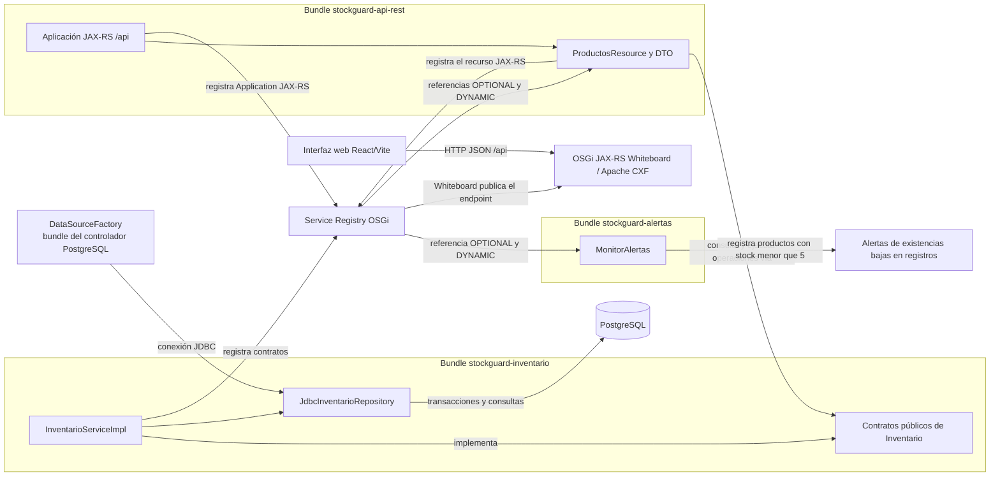

Inventario publica sus contratos solo después de conectarse a PostgreSQL e inicializar el esquema. Alertas y el recurso REST encuentran los contratos a través del registro. El Whiteboard publica el endpoint HTTP en el servidor de Karaf; la capa REST no conoce el repositorio ni la conexión JDBC.

### Bundle de Inventario

| Elemento | Responsabilidad |
|---|---|
| `Producto` | Registro de Java (`record`) con código, nombre y cantidad disponible. |
| `InventarioService` | API pública existente para listar productos y actualizar existencias. |
| `InventarioMovimientosService` | API pública complementaria para registrar entradas y salidas. |
| `InventarioConsultaService` | API pública para buscar un producto y consultar su historial de movimientos. |
| `MovimientoInventario` / `TipoMovimiento` | Tipos públicos inmutables para representar movimientos consultados. |
| `InventarioNoDisponibleException` | Comunica un fallo de persistencia sin exponer detalles SQL en la capa REST. |
| `InventarioServiceImpl` | Valida la configuración, inicializa el catálogo sin sobrescribir datos y publica los servicios mediante DS. |
| `JdbcInventarioRepository` | Implementación interna JDBC con operaciones transaccionales y bloqueo de fila al cambiar existencias. |

Los productos se guardan en PostgreSQL. Al activarse, el componente crea las tablas si no existen e inserta los 15 productos con `ON CONFLICT DO NOTHING`: reiniciar Karaf no duplica el catálogo ni repone cantidades que ya se cambiaron. `listarProductos()` devuelve la lista ordenada por código. `actualizarExistencias()` conserva el código y nombre y registra un movimiento `AJUSTE` cuando cambia la cantidad; una cantidad negativa se rechaza y un código desconocido devuelve `false`. Las operaciones de entrada y salida registran sus movimientos dentro de la misma transacción que actualiza el producto.

El POM de Inventario exporta `com.stockguard.inventario.api` como paquete público. `com.stockguard.inventario.internal` es implementación privada y no forma parte del contrato que consumen otros bundles. La interfaz `InventarioService` y el record `Producto` conservan su contrato; las operaciones de movimientos se exponen en la interfaz complementaria.

### Bundle de API REST

Este bundle separa el protocolo HTTP de la lógica de negocio y de la persistencia:

| Componente | Responsabilidad |
|---|---|
| `StockGuardApplication` | Registra la aplicación JAX-RS con base `/api` en el Whiteboard OSGi. |
| `StockGuardJsonProvider` | Publica el lector y escritor Jackson como extensión JSON asociada a la aplicación `stockguard`. |
| `ProductosResource` | Expone las rutas de productos y operaciones; consume los tres servicios públicos de Inventario con referencias `OPTIONAL` y `DYNAMIC`. |
| DTO (`ProductoDto`, `MovimientoDto`, `CantidadRequest`, `ErrorDto`) | Define la representación JSON de entrada y salida sin serializar directamente contratos internos. |
| `RestExceptionMapper` | Convierte errores HTTP o excepciones inesperadas en respuestas seguras. |

El bundle usa Apache Aries JAX-RS Whiteboard y Apache CXF, disponibles como features de Karaf. `StockGuardJsonProvider` extiende `JacksonJaxbJsonProvider` y se registra mediante DS como `MessageBodyReader` y `MessageBodyWriter`, asociado explícitamente a la aplicación `stockguard`. Así el Whiteboard puede serializar las listas y DTO de la API como JSON. La dependencia Jackson tiene alcance `provided`: el JAR REST importa su paquete desde la feature Jackson de Karaf, no lo incorpora ni duplica sus clases. CXF y las APIs OSGi/JAX-RS también las proporciona el runtime. En las pruebas se usa CXF embebido junto con el mismo proveedor. Si Inventario no está disponible, los recursos responden `503 Service Unavailable`; cuando reaparecen los servicios, DS vuelve a enlazarlos. REST no crea conexiones JDBC ni ejecuta SQL.

#### Endpoints

La base de la API es `http://localhost:8181/api` en la configuración HTTP predeterminada de Karaf. Todas las respuestas de recursos usan JSON; las operaciones POST reciben `{ "cantidad": n }`.

| Método | Ruta | Comportamiento | Respuesta satisfactoria |
|---|---|---|---|
| `GET` | `/api/productos` | Lista el catálogo ordenado por código. | `200` y lista de productos. |
| `GET` | `/api/productos/{codigo}` | Busca un producto. | `200` y producto; `404` si no existe. |
| `POST` | `/api/productos/{codigo}/entradas` | Registra entrada; `cantidad` debe ser positiva. | `204`; `404` si no existe. |
| `POST` | `/api/productos/{codigo}/salidas` | Registra salida; `cantidad` debe ser positiva y no exceder stock. | `204`; `404` si no existe; `409` si el movimiento no es posible. |
| `POST` | `/api/productos/{codigo}/ajustes` | Fija las existencias en la cantidad solicitada, incluido cero. | `204`; `404` si no existe. |
| `GET` | `/api/productos/{codigo}/movimientos` | Lista movimientos del más reciente al más antiguo. | `200` y lista, incluso vacía si el producto existe; `404` si no existe. |

Los códigos no válidos y las cantidades incorrectas responden `400`. Si el servicio de Inventario o su almacenamiento no están disponibles, la API responde `503`; los fallos no previstos usan `500` y un mensaje genérico. Los detalles técnicos se registran en Karaf, no se devuelven al cliente. La API no incluye autenticación ni CORS configurado.

#### Ejemplos de solicitudes y respuestas

Consulta de catálogo desde PowerShell:

~~~powershell
$productos = Invoke-RestMethod -Uri "http://localhost:8181/api/productos" -Method Get
$productos | ConvertTo-Json -Depth 5
~~~

Después de la secuencia manual descrita a continuación, la consulta de P-001 devuelve un DTO como este:

~~~json
{
  "codigo": "P-001",
  "nombre": "Teclado mecánico Logitech",
  "cantidadDisponible": 20
}
~~~

Las operaciones de escritura reciben un objeto JSON con la cantidad, por ejemplo {"cantidad":5} en una entrada, y responden 204 No Content si se aceptan. Los errores usan un objeto ErrorDto, por ejemplo:

~~~json
{"mensaje":"La cantidad debe ser mayor que cero."}
~~~

Los estados usados por la implementación son 400 Bad Request para formato o cantidad inválida, 404 Not Found para un producto inexistente, 409 Conflict cuando una salida excede las existencias, 503 Service Unavailable si Inventario o PostgreSQL no están disponibles y 500 Internal Server Error para un fallo no previsto.

#### Pruebas manuales de API reportadas en Karaf

Los resultados siguientes corresponden a peticiones manuales ejecutadas por el usuario en Apache Karaf; no se volvieron a ejecutar aquí para evitar escrituras adicionales en la base activa. La secuencia cambió P-001 de 12 a 17, luego a 15 y finalmente a 20 unidades:

| Solicitud | Resultado reportado |
|---|---|
| GET /api/productos | 200; devuelve los 15 productos. |
| GET /api/productos/P-001 | 200; devuelve el DTO de P-001. |
| GET /api/productos/P-001/movimientos | 200; devuelve el historial. |
| POST /api/productos/P-001/entradas con {"cantidad":5} | Aceptada; 12 → 17. |
| POST /api/productos/P-001/salidas con {"cantidad":2} | Aceptada; 17 → 15. |
| POST /api/productos/P-001/ajustes con {"cantidad":20} | Aceptada; 15 → 20. |
| Cantidad 0 | 400 Bad Request. |
| Producto P-999 | 404 Not Found. |
| Retirar 25 unidades cuando había 20 | 409 Conflict; el stock quedó en 20 y no se agregó movimiento. |

El historial comunicado y comprobado con una consulta SQL de solo lectura durante esta revisión es:

| ID | Tipo | Cantidad modificada | Existencia anterior | Existencia posterior |
|---:|---|---:|---:|---:|
| 1 | ENTRADA | 5 | 12 | 17 |
| 2 | SALIDA | 2 | 17 | 15 |
| 3 | AJUSTE | 5 | 15 | 20 |

La consulta de solo lectura al endpoint local GET /api/productos respondió 200 durante esta revisión. El cuerpo tenía bytes UTF-8 válidos y el encabezado fue Content-Type: application/json; en PowerShell 7.6.9, Invoke-RestMethod devolvió exactamente “Teclado mecánico Logitech”. No encontré evidencia de corrupción de texto en el servidor ni cambié la implementación por este motivo. Si una consola antigua muestra mecánico, prueba en PowerShell con una página de códigos UTF-8 y una consola que admita UTF-8:

~~~powershell
chcp 65001
$utf8 = [System.Text.UTF8Encoding]::new($false)
[Console]::InputEncoding = $utf8
[Console]::OutputEncoding = $utf8
$productos = Invoke-RestMethod -Uri "http://localhost:8181/api/productos" -Method Get
$productos[0].nombre
~~~

Si el problema persiste solo en una versión antigua de PowerShell, descarga la respuesta sin decodificarla en la terminal y vuelve a leerla como UTF-8:

~~~powershell
curl.exe --fail --silent --show-error "http://localhost:8181/api/productos" --output "$env:TEMP\stockguard-productos.json"
Get-Content -Raw -Encoding UTF8 "$env:TEMP\stockguard-productos.json" | ConvertFrom-Json
~~~

### Bundle de Alertas

`MonitorAlertas` es un componente inmediato de DS. Al activarse crea un programador de una sola hebra y ejecuta la consulta de inmediato y luego cada 10 segundos. La comparación es estricta: cinco unidades no generan alerta.

El monitor mantiene en memoria los códigos que ya tienen una alerta activa. Cuando un producto pasa de cinco o más unidades a menos de cinco, registra un único mensaje `WARN` con el prefijo `ALERTA:`. Las revisiones posteriores no repiten la notificación mientras el producto continúe bajo el umbral. Al observar cinco o más unidades, elimina el estado activo y registra una sola notificación `INFO` con el prefijo `RECUPERACIÓN:` y la cantidad disponible. Si vuelve a caer por debajo de cinco, comienza un nuevo ciclo de alerta.

La referencia opcional y dinámica se asocia y desvincula mediante métodos de DS. Si Inventario desaparece, el monitor permanece activo y las ejecuciones programadas esperan sin consultar; el estado de alertas activas se conserva y la desconexión no se interpreta como recuperación. Cuando el servicio vuelve a publicarse, DS lo asocia de nuevo: el mismo producto bajo continúa en su ciclo sin duplicar mensajes, y una recuperación ocurrida durante la desconexión se detecta en la siguiente consulta correcta. Una consulta fallida se registra como error y no modifica los estados. La sincronización de las revisiones protege las transiciones frente a ejecuciones simultáneas.

Al desactivarse, el componente borra su referencia, solicita el cierre inmediato del programador y espera su terminación hasta dos segundos. El paquete `com.stockguard.alertas.internal` es privado. Alertas importa el paquete público de Inventario con un rango de versión; el JAR de Alertas no incorpora copias de las clases de esa API.

## Comportamiento ante fallos

Inventario requiere PostgreSQL y un servicio OSGi DataSourceFactory para activarse. Si falta la configuración o la base de datos, el componente informa el fallo y no publica sus servicios; no usa una copia de datos en memoria. Si una consulta JDBC falla mientras el servicio está activo, la API devuelve 503 y el monitor registra el error sin borrar el estado de alerta.

Alertas y REST mantienen sus referencias opcionales y dinámicas. Cuando Inventario deja de publicar sus servicios, Alertas sigue activo y espera la reconexión; REST sigue disponible como aplicación HTTP, pero las operaciones que dependen de Inventario responden 503. Cuando los servicios vuelven al registro, Declarative Services enlaza de nuevo las referencias. Los bundles están en la misma instancia de Karaf: una caída completa de Karaf detiene toda la aplicación.

## Catálogo inicial

El componente de Inventario carga estos 15 productos al activarse:

| Código | Producto | Existencias iniciales |
|---|---|---:|
| P-001 | Teclado mecánico Logitech | 12 |
| P-002 | Mouse inalámbrico Logitech | 3 |
| P-003 | Monitor Samsung 24 pulgadas | 8 |
| P-004 | Cable HDMI 2 metros | 1 |
| P-005 | Memoria RAM Kingston 16 GB | 20 |
| P-006 | SSD Kingston 1 TB | 14 |
| P-007 | Audífonos HyperX Cloud | 4 |
| P-008 | Webcam Logitech C920 | 7 |
| P-009 | Adaptador USB-C | 2 |
| P-010 | Hub USB 3.0 | 18 |
| P-011 | Disco duro externo 2 TB | 6 |
| P-012 | Router TP-Link Wi-Fi 6 | 9 |
| P-013 | Fuente de poder 650 W | 11 |
| P-014 | Pasta térmica Arctic MX-4 | 25 |
| P-015 | Soporte para laptop | 5 |

Del catálogo, once productos comienzan con existencias normales (cinco o más). Los otros cuatro están bajo el umbral inicial:

| Código | Producto | Existencias |
|---|---|---:|
| P-002 | Mouse inalámbrico Logitech | 3 |
| P-004 | Cable HDMI 2 metros | 1 |
| P-007 | Audífonos HyperX Cloud | 4 |
| P-009 | Adaptador USB-C | 2 |

P-015 tiene exactamente cinco unidades y no genera una alerta. El umbral se aplica con la condición estricta `cantidadDisponible < 5`.

## Persistencia con PostgreSQL

PostgreSQL mantiene el catálogo y el historial de cambios fuera del ciclo de vida de Karaf. La lógica de inventario depende de una interfaz interna de repositorio; su implementación JDBC usa `DataSource` obtenido del servicio OSGi estándar `DataSourceFactory`. Así, el controlador permanece como bundle de infraestructura independiente y el bundle de Inventario no empaqueta clases del driver. Se eligió PostgreSQL por su soporte de transacciones, restricciones relacionales y bloqueos de fila, necesarios para actualizar cantidades y registrar su movimiento como una sola operación.

El esquema se crea al activar el componente y contiene:

| Tabla | Campos y reglas |
|---|---|
| `productos` | `codigo` como clave primaria; `nombre`; `cantidad_disponible` entera y no negativa; `fecha_creacion` y `fecha_actualizacion` con zona horaria. Código y nombre no pueden estar vacíos. |
| `movimientos_inventario` | Identificador `BIGINT` autogenerado; `codigo_producto` como clave foránea; tipo restringido a `ENTRADA`, `SALIDA` o `AJUSTE`; cantidad positiva, existencias anterior y posterior no negativas, fecha y observación opcional. Una restricción valida que el movimiento corresponda a las cantidades registradas. |

Las consultas de actualización usan una transacción y `SELECT ... FOR UPDATE`. Un cambio de existencias y su fila de movimiento se confirman juntos o se revierten juntos. Las entradas y salidas exigen una cantidad positiva; una salida mayor al stock actual se rechaza. La API existente conserva su comportamiento: cantidades negativas generan `IllegalArgumentException`, los códigos inexistentes devuelven `false` y un código nulo genera `NullPointerException`. Un error de conexión o SQL se reporta como fallo de persistencia y nunca se convierte en una lista vacía ni en un guardado simulado.

### Levantar PostgreSQL localmente

El archivo `docker-compose.yml` crea únicamente los recursos `stockguard-postgres`, `stockguard-postgres-data` y `stockguard-network`. Publica PostgreSQL en `127.0.0.1:5437` y usa el puerto interno `5432`. El puerto 5437 se comprobó disponible al preparar esta configuración. No se reutilizan ni se alteran otros contenedores, bases, volúmenes o redes.

En PowerShell, desde la raíz del repositorio:

```powershell
if (-not (Test-Path .env)) { Copy-Item .env.example .env }
notepad .env
docker compose up -d postgres
docker compose ps
Test-NetConnection -ComputerName localhost -Port 5437
```

Antes de iniciar, reemplaza `REEMPLAZAR_POR_UN_SECRETO_LOCAL` por una contraseña local segura en `.env`; ese archivo está excluido de Git. Karaf, ejecutado directamente en Windows, se conecta a `jdbc:postgresql://localhost:5437/stockguard_db`. Un componente que se ejecute dentro de la misma red Compose usa el nombre DNS `postgres` y el puerto interno 5432.

Para detener exclusivamente este servicio sin borrar su volumen:

```powershell
docker compose stop postgres
```

Para reanudarlo, ejecuta `docker compose start postgres`. No uses `docker compose down -v`: `-v` eliminaría los datos persistentes.

### Configurar el bundle en Karaf

El ejemplo externo está en `docs/configuracion/stockguard-inventario.cfg.example`. Con Karaf detenido o antes de iniciar una instalación de desarrollo, copia la configuración a su directorio `etc`:

```powershell
Copy-Item .\docs\configuracion\stockguard-inventario.cfg.example `
  "$env:KARAF_HOME\etc\com.stockguard.inventario.internal.InventarioServiceImpl.cfg"
notepad "$env:KARAF_HOME\etc\com.stockguard.inventario.internal.InventarioServiceImpl.cfg"
```

El ejemplo configura URL y usuario. Proporciona la contraseña mediante la variable de entorno `STOCKGUARD_DB_PASSWORD` antes de iniciar Karaf, o agrega `jdbc.password` al archivo local de Config Admin fuera del repositorio. No guardes contraseñas reales en el código ni en Git. Si la conexión no está disponible, DS deja el componente sin activar y los servicios de Inventario no se publican.

Karaf debe ofrecer la especificación JDBC OSGi y el servicio de fábrica del driver. En su consola, instala la feature de JDBC de Karaf y el bundle PgJDBC:

```text
karaf@root()> feature:install jdbc
karaf@root()> bundle:install -s mvn:org.postgresql/postgresql/42.7.14
karaf@root()> service:list org.osgi.service.jdbc.DataSourceFactory
```

La primera orden instala infraestructura de Karaf; la segunda instala el driver PostgreSQL como bundle externo de terceros, no como un módulo de aplicación StockGuard. Verifica que `DataSourceFactory` aparezca antes de iniciar Inventario. Estas instrucciones no se han ejecutado contra la instalación Karaf del usuario durante esta fase.

La conexión sobrevive a reinicios de Karaf porque reside en el volumen Docker. Al reactivar el componente, las sentencias `CREATE TABLE IF NOT EXISTS` y `INSERT ... ON CONFLICT DO NOTHING` crean lo que falte, conservan las cantidades modificadas y evitan duplicados.

## Estructura del proyecto

```text
StockGuard/
├── README.md
├── pom.xml                              # Agregador Maven; packaging=pom
├── .gitignore
├── .env.example
├── docker-compose.yml
├── docs/
│   ├── configuracion/
│   │   └── stockguard-inventario.cfg.example
│   └── capturas/
├── stockguard-inventario/
│   ├── pom.xml
│   └── src/
│       ├── main/
│       │   ├── java/com/stockguard/inventario/
│       │   │   ├── api/
│       │   │   │   ├── InventarioService.java
│       │   │   │   ├── InventarioMovimientosService.java
│       │   │   │   ├── InventarioConsultaService.java
│       │   │   │   ├── InventarioNoDisponibleException.java
│       │   │   │   ├── MovimientoInventario.java
│       │   │   │   ├── Producto.java
│       │   │   │   └── TipoMovimiento.java
│       │   │   └── internal/
│       │   │       ├── InventarioRepository.java
│       │   │       ├── InventarioPersistenceException.java
│       │   │       ├── JdbcInventarioRepository.java
│       │   │       └── InventarioServiceImpl.java
│       │   └── resources/db/schema.sql
│       └── test/java/com/stockguard/inventario/internal/
│           └── InventarioServiceImplTest.java
├── stockguard-alertas/
│   ├── pom.xml
│   └── src/
│       ├── main/java/com/stockguard/alertas/internal/
│       │   └── MonitorAlertas.java
│       └── test/java/com/stockguard/alertas/internal/
│           └── MonitorAlertasTest.java
├── stockguard-api-rest/
│   ├── pom.xml
│   └── src/
│       ├── main/java/com/stockguard/api/rest/internal/
│       │   ├── StockGuardApplication.java
│       │   ├── StockGuardJsonProvider.java
│       │   ├── ProductosResource.java
│       │   ├── RestExceptionMapper.java
│       │   └── dto/
│       │       ├── CantidadRequest.java
│       │       ├── ErrorDto.java
│       │       ├── MovimientoDto.java
│       │       └── ProductoDto.java
│       └── test/java/com/stockguard/api/rest/internal/
│           ├── ProductosResourceTest.java
│           ├── RestExceptionMapperTest.java
│           ├── ProductosResourceIntegrationTest.java
│           ├── ProductosResourceErroresTest.java
│           └── CantidadRequestHttpTest.java
└── stockguard-frontend/
    ├── .env.example
    ├── index.html
    ├── package.json
    ├── package-lock.json
    ├── vite.config.ts
    └── src/
        ├── api/
        ├── components/
        ├── context/
        ├── domain/
        ├── hooks/
        ├── layout/
        ├── pages/
        ├── styles/
        └── test/
```

El paquete `com.stockguard.inventario.api` forma el contrato público entre bundles. Los paquetes `internal` de Inventario, Alertas y REST son privados. Los DTO REST son representaciones HTTP y no forman parte del API OSGi de Inventario. Los directorios `target/` se generan durante la compilación y no son parte del código fuente.

## Requisitos previos

- JDK 17.
- Maven 3.10.0 o una versión compatible con el POM.
- Apache Karaf 4.4.x para ejecutar los bundles.
- Docker Desktop con Docker Compose para PostgreSQL local y las pruebas de integración.
- PostgreSQL 16 en contenedor; no hace falta instalar el servidor directamente en Windows.
- Node.js 22.12 o posterior y npm para ejecutar la interfaz web (Vite y Vitest).
- Git.
- Como herramientas de desarrollo, un IDE Java como IntelliJ IDEA, Eclipse o VS Code con soporte Java.

Versiones y alcances declarados en los POM:

| Componente | Versión | Alcance |
|---|---:|---|
| Apache Felix Maven Bundle Plugin | 5.1.9 | Empaquetado OSGi de los tres bundles de aplicación. |
| Maven Compiler Plugin | 3.13.0 | Compilación con `--release 17`. |
| Anotaciones OSGi Declarative Services | 1.5.1 | `provided`. |
| API JDBC de OSGi | 1.1.0 | `provided` en Inventario; Karaf la ofrece mediante la feature `jdbc`. |
| API de servicios JAX-RS de OSGi | 1.0.0 | `provided` en REST. |
| API JAX-RS `javax` de Aries | 1.0.1 | `provided` en REST; declara el contrato JAX-RS 2.1. |
| JUnit Jupiter | 5.14.4 | `test`. |
| PostgreSQL JDBC | 42.7.14 | `test` para pruebas; se instala como bundle externo en Karaf. |
| Testcontainers | 2.0.5 | `test`, módulos PostgreSQL y JUnit Jupiter. |
| Mockito Core | 5.24.0 | `test`, en Alertas y REST. |
| Apache CXF JAX-RS | 3.6.12 | `test` en REST; Karaf aporta el runtime CXF compatible. |
| Aries JAX-RS Whiteboard | 2.0.2 | Feature OSGi que publica recursos JAX-RS en Karaf. |
| Jackson JAX-RS Provider | 2.14.1 | provided en REST; Aries Jackson debe proporcionar el paquete en Karaf y sus clases no se incrustan en el bundle. |
| SLF4J API | 1.7.36 | `provided` en los tres bundles. |
| Logback Classic | 1.2.13 | `test`, en Alertas. |
| Maven Surefire Plugin | 3.6.1 | Ejecución de pruebas. |

Comprueba las herramientas desde PowerShell:

```powershell
java --version
mvn --version
node --version
npm --version
git --version
```

En la consola de Karaf, `version` muestra la versión del contenedor:

```text
karaf@root()> version
```

## Compilación y pruebas

Desde el directorio raíz del repositorio y con Docker Desktop disponible, ejecuta:

```powershell
mvn clean verify
```

Maven ejecuta el reactor en el orden definido por las dependencias: primero procesa el agregador, construye Inventario, Alertas y REST. `clean` elimina resultados anteriores; `verify` ejecuta las fases previas, las pruebas configuradas por Surefire y las verificaciones del ciclo Maven. El resultado `BUILD SUCCESS` indica que los cuatro proyectos del reactor terminaron sin errores.

JUnit Jupiter 5 ejecuta las pruebas de los módulos. Inventario usa PostgreSQL real en un contenedor Testcontainers; Alertas y REST usan Mockito para controlar los contratos de Inventario. REST incluye pruebas unitarias directas y pruebas HTTP con un servidor CXF embebido y un puerto loopback efímero. Ese servidor no es Karaf ni PostgreSQL. Las dependencias de pruebas tienen alcance `test` y no se empaquetan en los bundles.

La ejecución de mvn clean verify realizada el 2026-11-08 pasó 96 pruebas: 21 en Inventario contra PostgreSQL real mediante Testcontainers, 16 en Alertas y 59 en REST, sin fallos, errores ni pruebas omitidas. Las capturas 01 y 02 son anteriores a REST y no muestran esta ejecución.

Los bundles generados están en:

```text
stockguard-inventario/target/stockguard-inventario-1.0.0-SNAPSHOT.jar
stockguard-alertas/target/stockguard-alertas-1.0.0-SNAPSHOT.jar
stockguard-api-rest/target/stockguard-api-rest-1.0.0-SNAPSHOT.jar
```

Los informes XML y de texto de Surefire quedan bajo `target/surefire-reports/` en cada módulo.

## Ejecución en Apache Karaf

Las instrucciones separan PowerShell de la consola interactiva de Karaf. PostgreSQL, el controlador OSGi y la configuración del componente deben estar listos antes de iniciar Inventario. Si ya existe una instancia Karaf en uso, no la detengas ni la actualices hasta elegir explícitamente un entorno de desarrollo.

### 1. Iniciar PostgreSQL y configurar el componente

En PowerShell, desde la raíz del repositorio, crea un archivo local de variables y levanta solo el servicio de StockGuard:

```powershell
if (-not (Test-Path .env)) { Copy-Item .env.example .env }
notepad .env
docker compose up -d postgres
docker compose ps
Test-NetConnection -ComputerName localhost -Port 5437
```

Edita `.env` para cambiar el valor de ejemplo de `STOCKGUARD_DB_PASSWORD`. Si cambias el usuario o nombre de base de datos, actualiza también `jdbc.user` o `jdbc.url` en la configuración de Karaf. Copia la configuración de Inventario solo si todavía no existe, para conservar los ajustes locales; si no usarás la variable de entorno, agrega `jdbc.password` al archivo local de Config Admin:

```powershell
$configInventario = Join-Path $env:KARAF_HOME `
  "etc\com.stockguard.inventario.internal.InventarioServiceImpl.cfg"
if (-not (Test-Path $configInventario)) {
  Copy-Item .\docs\configuracion\stockguard-inventario.cfg.example $configInventario
}
notepad "$env:KARAF_HOME\etc\com.stockguard.inventario.internal.InventarioServiceImpl.cfg"
```

La contraseña guardada en Config Admin queda en la instalación de Karaf, fuera del repositorio. Como alternativa, define `STOCKGUARD_DB_PASSWORD` en el entorno del proceso antes de iniciar Karaf.

### 2. Iniciar Karaf y habilitar JDBC y DS

En PowerShell, cambia al directorio de tu instalación y ejecuta:

```powershell
Set-Location $env:KARAF_HOME
.\bin\karaf.bat
```

En la consola de Karaf:

```text
karaf@root()> version
karaf@root()> feature:install scr
karaf@root()> feature:install jdbc
karaf@root()> feature:repo-list
karaf@root()> feature:list -i
karaf@root()> bundle:list
```

Si faltan los repositorios, agrégalos una vez con versiones alineadas con Karaf 4.4.12 y comprueba luego `feature:repo-list`:

```text
karaf@root()> feature:repo-add mvn:org.ops4j.pax.web/pax-web-features/8.0.35/xml/features
karaf@root()> feature:repo-add mvn:org.apache.cxf.karaf/apache-cxf/3.6.12/xml/features
karaf@root()> feature:repo-add mvn:org.apache.aries.jax.rs/org.apache.aries.jax.rs.features/2.0.2/xml
```

Instala solo las features que no aparecen como instaladas en `feature:list -i`:

```text
karaf@root()> feature:install http-whiteboard/8.0.35
karaf@root()> feature:install aries-jax-rs-whiteboard/2.0.2 aries-jax-rs-whiteboard-jackson/2.0.2
```

Aries Whiteboard conecta los servicios JAX-RS con el runtime HTTP y CXF de Karaf; la feature Jackson agrega el proveedor JSON. No instales CXF ni Jackson como dependencias adicionales dentro del JAR de StockGuard.

Busca `org.postgresql.jdbc` en la lista. Solo si el controlador aún no está instalado, ejecuta:

```text
karaf@root()> bundle:install -s mvn:org.postgresql/postgresql/42.7.14
```

Después, confirma que el servicio JDBC esté disponible:

```text
karaf@root()> service:list org.osgi.service.jdbc.DataSourceFactory
```

Verifica Karaf 4.4.x y que el controlador haya registrado `DataSourceFactory` para `org.postgresql.Driver`.

### 3. Compilar y preparar las ubicaciones locales

En otra ventana de PowerShell, desde la raíz del repositorio:

```powershell
mvn clean verify

$inventarioJar = (Resolve-Path ".\stockguard-inventario\target\stockguard-inventario-1.0.0-SNAPSHOT.jar").Path
$alertasJar = (Resolve-Path ".\stockguard-alertas\target\stockguard-alertas-1.0.0-SNAPSHOT.jar").Path
$apiRestJar = (Resolve-Path ".\stockguard-api-rest\target\stockguard-api-rest-1.0.0-SNAPSHOT.jar").Path
$inventarioUrl = ([System.Uri]::new($inventarioJar)).AbsoluteUri
$alertasUrl = ([System.Uri]::new($alertasJar)).AbsoluteUri
$apiRestUrl = ([System.Uri]::new($apiRestJar)).AbsoluteUri

$inventarioUrl
$alertasUrl
$apiRestUrl
```

Copia las URL `file:///...` impresas para usarlas en la consola de Karaf. Esto evita fijar la ubicación local del repositorio en las instrucciones.

### 4. Instalar o actualizar los bundles sin duplicarlos

En Karaf, ejecuta `bundle:list` y busca los nombres simbólicos `com.stockguard.inventario`, `com.stockguard.alertas` y `com.stockguard.api.rest`. Los ID numéricos dependen de cada contenedor. Como el contrato de Inventario añadió consultas públicas, actualiza el bundle ya instalado en vez de instalar otra copia. Alertas mantiene compatibilidad con el rango de API `[1.0,2)`.

Actualiza la instalación existente de Inventario con el JAR compilado:

```text
karaf@root()> bundle:update <ID_INVENTARIO> 'file:///ruta/local/stockguard-inventario/target/stockguard-inventario-1.0.0-SNAPSHOT.jar'
```

Si `com.stockguard.api.rest` todavía no aparece en `bundle:list`, instala el bundle REST nuevo una sola vez:

```text
karaf@root()> bundle:install -s 'file:///ruta/local/stockguard-api-rest/target/stockguard-api-rest-1.0.0-SNAPSHOT.jar'
```

Si ya aparece instalado, actualiza ese mismo ID en vez de instalar otra copia:

```text
karaf@root()> bundle:update <ID_API_REST> 'file:///ruta/local/stockguard-api-rest/target/stockguard-api-rest-1.0.0-SNAPSHOT.jar'
```

No reinstales ni actualices Alertas si no cambió su código. Revisa `bundle:list`; si hace falta, inicia el bundle con `bundle:start <ID>`. Un error de base de datos, configuración o `DataSourceFactory` dejará Inventario sin activar; en ese caso, REST permanecerá activo pero responderá `503`.

### 5. Comprobar servicios y registros

En Karaf:

```text
karaf@root()> bundle:list
karaf@root()> service:list com.stockguard.inventario.api.InventarioService
karaf@root()> service:list com.stockguard.inventario.api.InventarioMovimientosService
karaf@root()> service:list com.stockguard.inventario.api.InventarioConsultaService
karaf@root()> log:display
```

Se espera que los tres bundles de aplicación estén `Active` y que el registro muestre los servicios de Inventario. Con HTTP Whiteboard activo, prueba el endpoint desde PowerShell:

```powershell
Invoke-RestMethod -Uri "http://localhost:8181/api/productos" -Method Get
Invoke-RestMethod -Uri "http://localhost:8181/api/productos/P-001" -Method Get
Invoke-RestMethod -Uri "http://localhost:8181/api/productos/P-001/movimientos" -Method Get
# Estas llamadas POST cambian existencias; ejecútalas solo en una base de desarrollo.
Invoke-RestMethod -Uri "http://localhost:8181/api/productos/P-001/entradas" `
  -Method Post -ContentType "application/json" -Body '{"cantidad":2}'
Invoke-RestMethod -Uri "http://localhost:8181/api/productos/P-001/salidas" `
  -Method Post -ContentType "application/json" -Body '{"cantidad":1}'
Invoke-RestMethod -Uri "http://localhost:8181/api/productos/P-001/ajustes" `
  -Method Post -ContentType "application/json" -Body '{"cantidad":8}'
```

El puerto HTTP predeterminado de Karaf es `8181`; si la instalación usa otra configuración, sustituye el puerto. Los registros de Inventario indican que PostgreSQL se inicializó; Alertas registra las transiciones de los cuatro productos bajo el umbral. El monitor ejecuta una primera revisión al activarse y repite cada 10 segundos.

### Comprobar la persistencia con consultas de solo lectura

Estas consultas muestran las tablas, el catálogo almacenado y el historial de P-001 sin cambiar la base:

~~~powershell
docker exec stockguard-postgres psql -U stockguard -d stockguard_db -c "\dt"
docker exec stockguard-postgres psql -U stockguard -d stockguard_db -c "SELECT codigo, nombre, cantidad_disponible FROM productos ORDER BY codigo;"
docker exec stockguard-postgres psql -U stockguard -d stockguard_db -c "SELECT id, tipo_movimiento, cantidad_modificada, existencia_anterior, existencia_posterior FROM movimientos_inventario WHERE codigo_producto = 'P-001' ORDER BY id;"
~~~

Para comprobar persistencia después de reactivar Inventario, anota primero el valor devuelto por el SELECT, inicia y detén únicamente el bundle en un Karaf de desarrollo y vuelve a ejecutar la consulta. El catálogo inicial se inserta con ON CONFLICT DO NOTHING; la reactivación no repone ni duplica existencias. No se necesita ni se recomienda actualizar cantidades directamente con SQL, porque esa vía no registra un movimiento.

## Interfaz web

El directorio stockguard-frontend contiene una aplicación de una sola página implementada con React y TypeScript, servida en desarrollo por Vite. Incluye un panel general, catálogo con búsqueda, filtros y ordenamiento, detalle e historial de movimientos, formularios para entradas, salidas y ajustes, y una vista de productos bajo el umbral. La vista de alertas consulta el inventario actual; el historial de alertas sigue disponible únicamente en los registros de Karaf.

La interfaz consume la API REST y no accede a PostgreSQL. En desarrollo, el proxy de Vite reenvía las rutas /api al servidor Karaf en http://localhost:8181. Para cambiar el destino, se puede definir STOCKGUARD_PROXY_TARGET en un archivo local basado en .env.example.

Desde PowerShell, con la API REST en ejecución:

~~~powershell
Set-Location stockguard-frontend
npm ci
npm test
npm run build
npm run lint
npm run dev
~~~

La ejecución local de esta revisión pasó 72 pruebas en siete archivos; la compilación de producción y oxlint también finalizaron correctamente. Vite inicia el servidor de desarrollo en el puerto 5173. El artefacto de dist se genera localmente, pero el proyecto no configura su publicación desde Karaf.

## Demostración de desconexión y recuperación

Esta demostración cambia el estado de bundles en un contenedor Karaf. Debe realizarse en un entorno de desarrollo; no es una prueba automatizada de unidad.

1. En Karaf, ejecuta `bundle:list` y anota los ID actuales de Inventario, Alertas y API REST por sus nombres simbólicos.
2. Detén Inventario:

   ```text
   karaf@root()> bundle:stop <ID_INVENTARIO>
   ```

3. Ejecuta `bundle:list`. Inventario debe aparecer como `Resolved`; Alertas y API REST deben seguir `Active`. Mientras Inventario esté ausente, una consulta HTTP responde `503 Service Unavailable`.
4. Revisa la desconexión en los registros:

   ```text
   karaf@root()> log:display
   ```

   Se espera el mensaje `Servicio de Inventario desconectado. El monitor continuará esperando la reconexión.`
5. Inicia Inventario de nuevo:

   ```text
   karaf@root()> bundle:start <ID_INVENTARIO>
   ```

6. Confirma que los tres bundles estén `Active` y que `service:list com.stockguard.inventario.api.InventarioService` muestre el servicio.
7. Repite `Invoke-RestMethod -Uri "http://localhost:8181/api/productos" -Method Get`; la API debe responder de nuevo. Revisa los registros para la reconexión y las alertas de existencias bajas. La siguiente consulta de Alertas debe ocurrir dentro del intervalo de 10 segundos sin reiniciar ese bundle.

Estos son los resultados esperados según el diseño del componente. La verificación manual de desconexión y reconexión se reportó en una ejecución anterior de Karaf; no se ha repetido como parte de esta fase documental.

## Pruebas automatizadas

Las pruebas automatizadas cubren los tres bundles:

| Clase | Cobertura principal |
|---|---|
| `InventarioServiceImplTest` | Integración contra PostgreSQL real con Testcontainers: conexión, catálogo idempotente, consultas, ajustes, entradas/salidas, movimientos, validaciones, rollback, persistencia tras recrear el componente y concurrencia. |
| `MonitorAlertasTest` | Umbral, deduplicación, recuperación en cinco unidades y por encima, nuevo ciclo tras una caída, independencia entre productos, desconexión/reconexión, fallos de consulta, concurrencia y cierre del programador. |
| `ProductosResourceTest` | Validación de códigos y cantidades, conversión a DTO, estados HTTP, ausencia de servicios y manejo de errores. |
| `RestExceptionMapperTest` | Conservación de estados HTTP y ocultamiento de detalles internos en errores. |
| `ProductosResourceIntegrationTest` | Solicitudes HTTP a CXF embebido para JSON, operaciones POST y errores de validación. |
| `CantidadRequestHttpTest` | Contrato de cuerpos JSON estrictos y respuestas HTTP 400 para cantidades inválidas. |
| `ProductosResourceErroresTest` | Estados HTTP para errores de validación, producto inexistente, conflicto, indisponibilidad y fallos internos. |

JUnit Jupiter proporciona las aserciones y el ciclo de ejecución. Testcontainers inicia una instancia efímera de PostgreSQL para verificar el SQL, las restricciones y las transacciones contra el motor real; Docker debe estar activo al ejecutar esas pruebas. Mockito controla los servicios OSGi de Inventario en Alertas y REST sin iniciar Karaf. El monitor usa un programador controlado, por lo que sus pruebas no esperan diez segundos de reloj por ciclo.

Las pruebas de Inventario son de integración con PostgreSQL. Las de REST ejercitan HTTP sobre CXF local y servicios simulados; no comprueban el descubrimiento del Whiteboard ni la conexión entre bundles dentro de Karaf. Esa validación de runtime se debe realizar con los pasos anteriores; la evidencia manual existente corresponde a la arquitectura anterior a REST.

## Evidencias de ejecución

Las capturas PNG que ya existen se conservaron sin cambios. Se revisaron visualmente; varias son evidencia histórica de la etapa de dos bundles y muestran la versión de Alertas anterior a la deduplicación. No demuestran por sí solas el estado actual del runtime ni reemplazan la verificación reciente de Maven.

### Evidencia histórica de Maven y del runtime inicial

La primera captura muestra una ejecución antigua de Maven con nueve pruebas de Inventario, sin fallos, errores ni omisiones. No refleja las 96 pruebas ejecutadas en esta revisión.

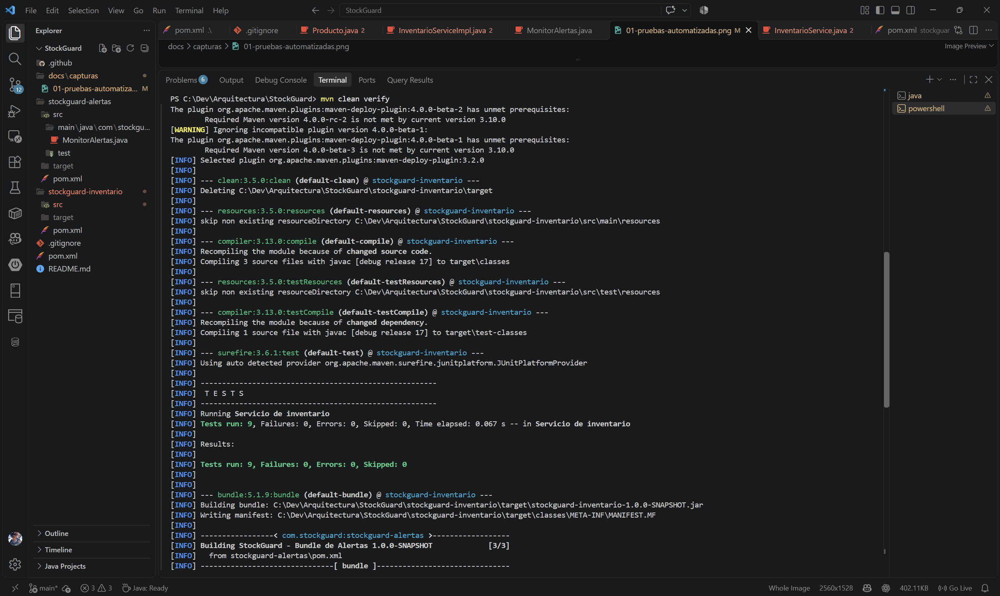

La segunda captura muestra un resumen anterior del reactor con el agregador, Inventario y Alertas. Todavía no incluía el bundle REST.

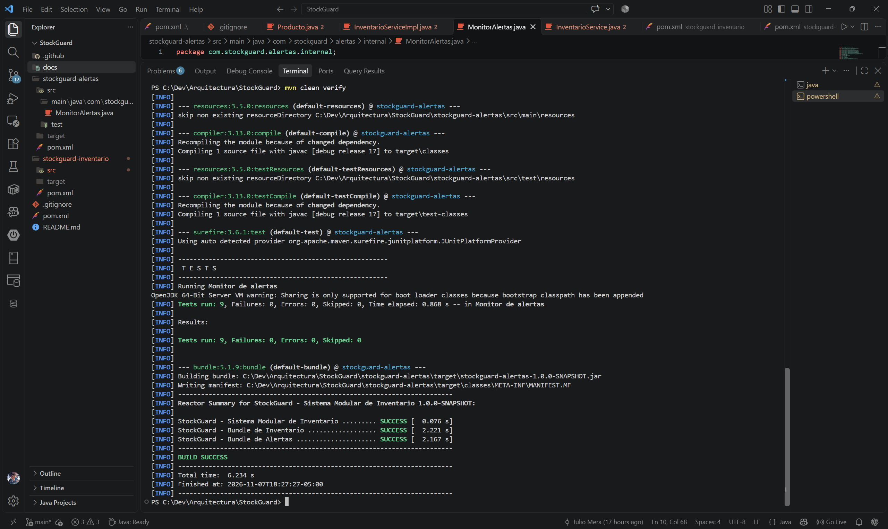

Esta imagen es de Karaf y muestra Inventario y Alertas activos. No muestra el bundle de API REST.

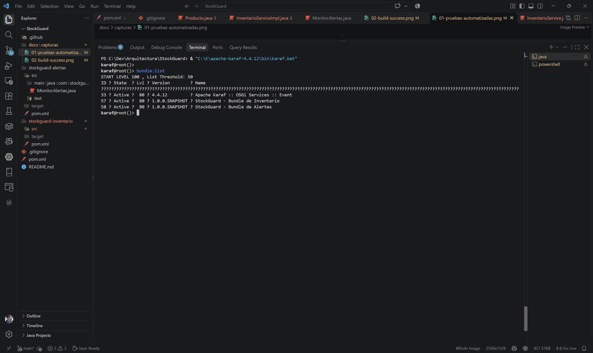

La salida de bundle:services 57 muestra InventarioService publicado en una ejecución anterior. No incluye la evidencia actual de los tres contratos públicos.

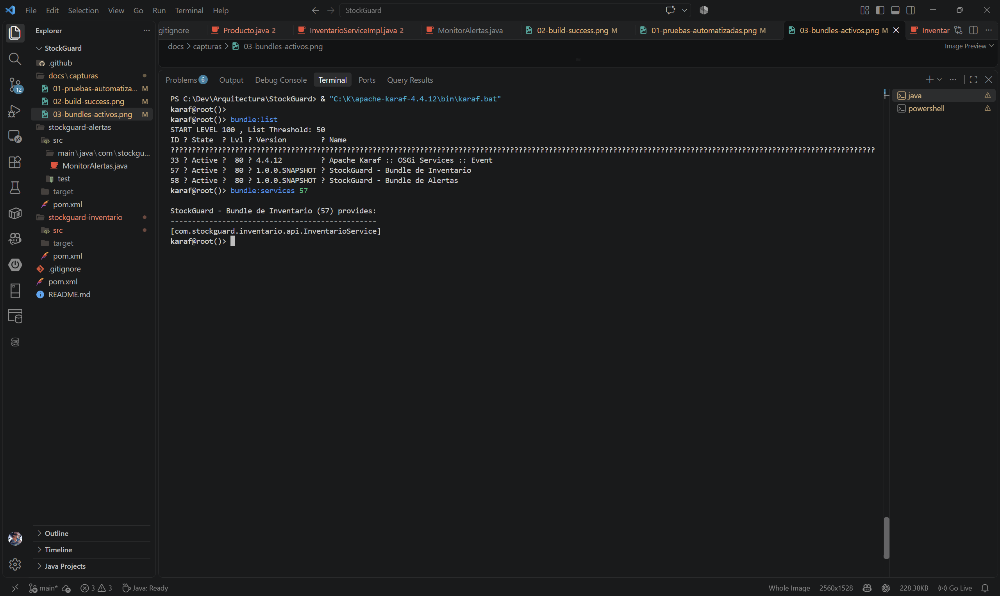

Las capturas siguientes muestran alertas y la demostración de desconexión y reconexión de Inventario. Fueron tomadas antes de completar la deduplicación: las imágenes 05, 06, 08 y 09 muestran avisos repetidos por ciclo y no representan el comportamiento actual esperado. Se conservan como evidencia histórica; la imagen 07 contiene el mensaje de desconexión.

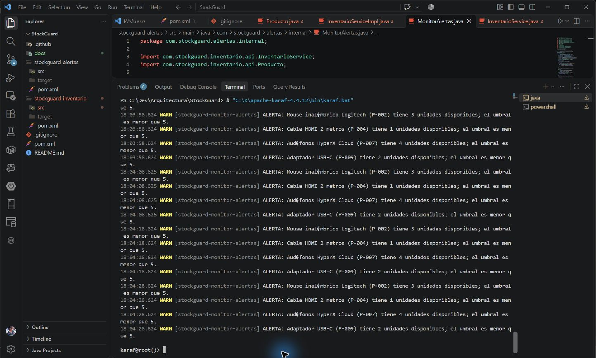

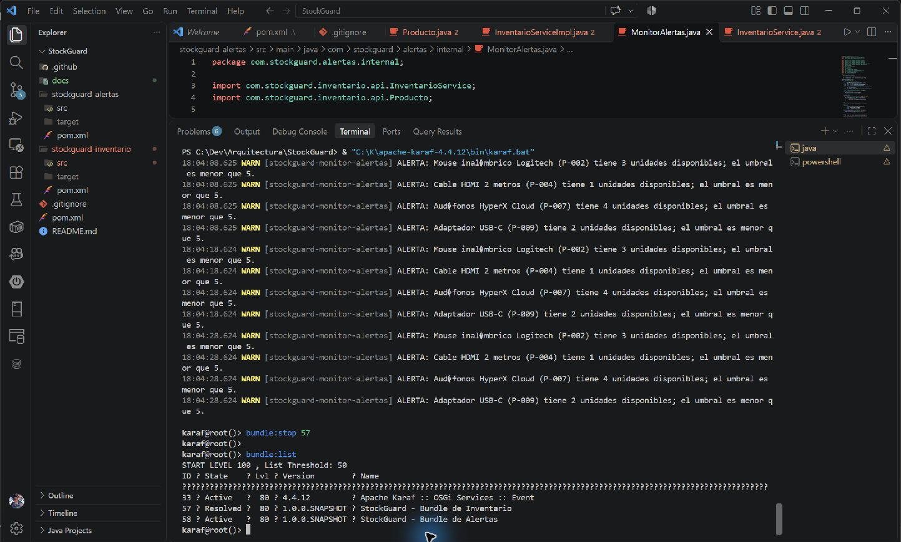

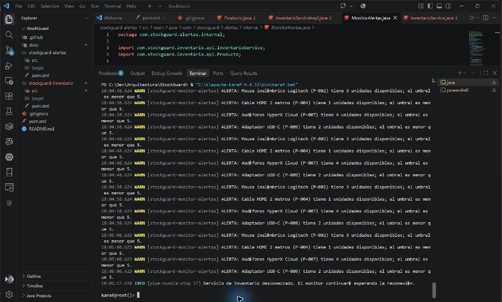

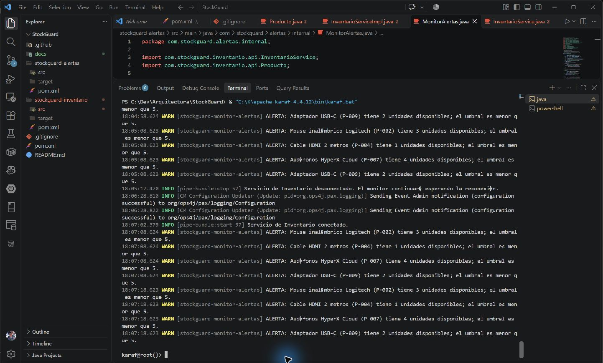

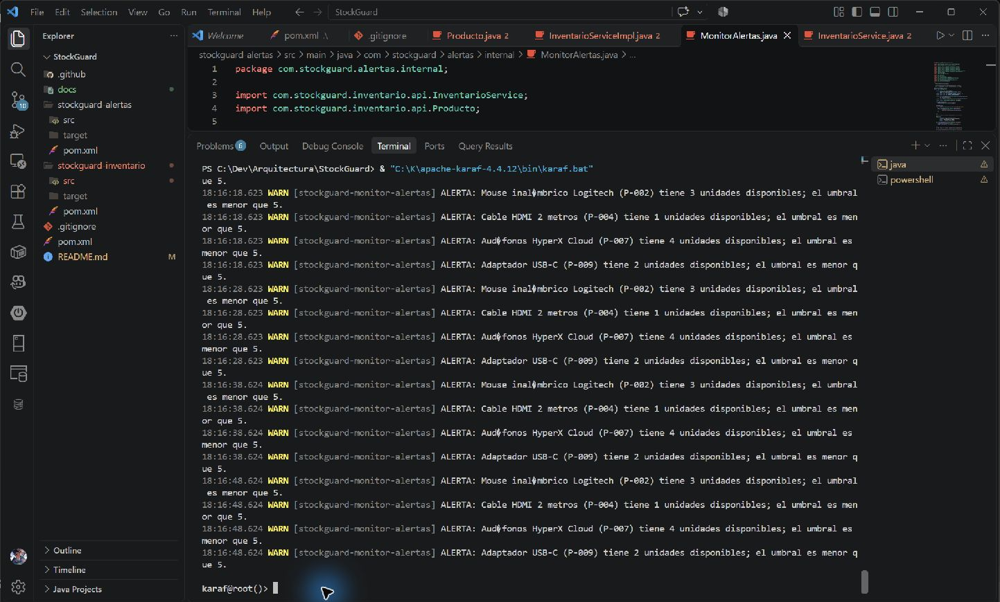

### Evidencia de REST y de cambios posteriores

Estas capturas documentan ejecuciones de la API REST y operaciones OSGi posteriores. Se verificó que cada archivo PNG abre correctamente. Las imágenes de PowerShell que muestran caracteres acentuados incorrectos documentan la presentación de esa consola; no se usan para afirmar que el servidor haya alterado el JSON.

La captura 10 contiene ciclos anteriores con avisos repetidos y, tras actualizar Alertas, el grupo inicial de alertas. No basta por sí sola para demostrar la ausencia de duplicados en ciclos posteriores.

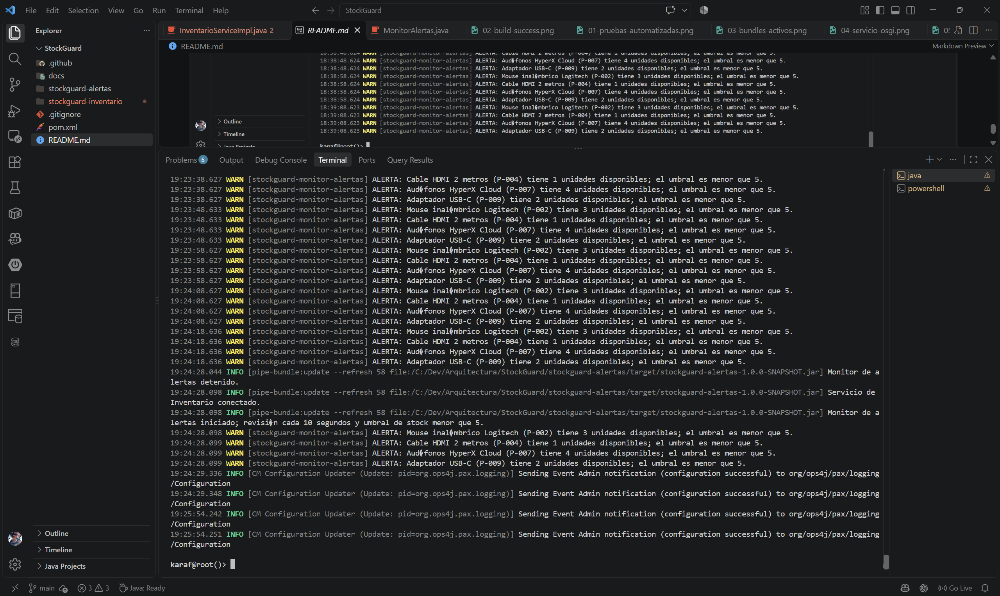

La consola muestra varios cuerpos de solicitud inválidos y el estado HTTP 400 devuelto por la API.


La inspección DS muestra el proveedor Jackson activo, registrado como lector y escritor JSON y asociado a la aplicación StockGuard.


La consulta de P-001 y su historial devuelve el producto y los tres movimientos registrados. La consola visible representa incorrectamente algunos acentos.


La evidencia muestra Alertas detenido mientras Inventario y la API REST permanecen activos.


Tras iniciar Alertas, la lista muestra activos los tres bundles de aplicación.


La respuesta REST contiene los quince productos; la consola muestra una codificación visual incorrecta de algunos acentos.


Al detener Inventario, la consulta REST devuelve HTTP 503.


Después de iniciar Inventario, una consulta posterior vuelve a responder HTTP 200 y entrega el catálogo.


### Extractos de texto históricos

Se conservan estos registros de ejecuciones anteriores. Sirven como contexto complementario, pero no sustituyen las capturas actuales pendientes ni verifican el bundle REST:

- [Salida histórica de pruebas de Maven](docs/capturas/01-pruebas-automatizadas.txt).
- [Resumen histórico del reactor Maven](docs/capturas/02-build-success.txt).
- [Registro histórico de Karaf](docs/capturas/03-registro-karaf.txt).

### Matriz de evidencia para la entrega

| Evidencia solicitada | Estado |
|---|---|
| Diagrama general de arquitectura | El diagrama Mermaid está incluido en esta página; falta una captura PNG independiente si la entrega la exige. |
| Resultado actual de pruebas Maven y resumen del reactor | Pendiente de captura. Las imágenes 01 y 02 son históricas; el build de esta revisión ejecutó 96 pruebas. |
| Los tres bundles activos en Karaf | Capturado en 15; la captura 03 es histórica y solo muestra Inventario y Alertas. |
| Servicios OSGi de Inventario registrados | Parcial. La captura 04 muestra InventarioService en una ejecución anterior; la 12 confirma el proveedor JSON activo. Falta la salida actual de bundle:services para Inventario. |
| Tablas PostgreSQL | Pendiente de captura. Las tablas productos y movimientos_inventario existen. |
| Los 15 productos almacenados en PostgreSQL | Pendiente de captura. |
| Alertas actuales sin duplicados | Parcial. Las capturas 05, 06, 08 y 09 son anteriores a la deduplicación; la 10 muestra la actualización y el primer grupo de alertas, pero no un ciclo posterior sin duplicados. |
| Colas y mensajes de Apache Artemis | No aplica: Artemis/JMS no está implementado. |
| Consulta REST del catálogo y producto P-001 | Capturado en 13 y 16. La consola de esas imágenes muestra acentos incorrectos. |
| Registro REST de entrada | Pendiente de captura. La operación fue reportada manualmente y no se repitió en esta revisión. |
| Registro REST de salida | Pendiente de captura. La operación fue reportada manualmente y no se repitió en esta revisión. |
| Registro REST de ajuste | Pendiente de captura. La operación fue reportada manualmente y no se repitió en esta revisión. |
| Historial de movimientos de P-001 | Capturado en 13; los movimientos también se comprobaron mediante una consulta SQL de solo lectura. |
| Respuesta HTTP 400 | Capturado en 11 para cuerpos JSON y cantidades inválidos. |
| Respuesta HTTP 404 | Pendiente de captura; el resultado manual se documentó arriba. |
| Respuesta HTTP 409 | Pendiente de captura; el stock y la ausencia de movimiento adicional se documentaron arriba. |
| Inventario no disponible por HTTP | Capturado en 17 con respuesta 503. |
| Recuperación de consultas tras reiniciar Inventario | Capturado en 18 con respuesta posterior 200. |

Las imágenes 01 a 09 conservan los mismos bytes que las evidencias históricas ya versionadas; se normalizaron los nombres que tenían el sufijo (1) sin cambiar su contenido. Las capturas 10 a 18 se incorporan como evidencia nueva. No hay capturas de tablas ni de consultas directas a PostgreSQL, ni de las operaciones POST aceptadas o de los errores HTTP 404 y 409.

### Cómo obtener las capturas pendientes

Abre la salida correcta en la ventana correspondiente y usa Recortes de Windows para guardar el área como PNG en docs/capturas. Comprueba el archivo antes de insertarlo en Markdown.

Para reemplazar las capturas antiguas de Maven, ejecuta desde la raíz del proyecto y captura primero los resultados de Surefire y luego el resumen final del reactor:

~~~powershell
mvn clean verify
~~~

Los nombres sugeridos son 19-pruebas-maven-actuales.png y 20-build-success-actual.png. La ejecución documentada pasó 96 pruebas y terminó en BUILD SUCCESS; no reutilices las imágenes históricas 01 y 02 para representar esa ejecución.

En la consola de Karaf, sin cambiar el estado de los bundles:

~~~text
bundle:list
bundle:services <ID_INVENTARIO>
log:display -n 30
~~~

Los ID se deben descubrir en la misma ejecución con bundle:list. Para la evidencia OSGi, captura la lista de los tres bundles activos, el resultado de bundle:services para Inventario y las alertas actuales del monitor.

En PowerShell, las consultas de base de datos son de solo lectura:

~~~powershell
docker exec stockguard-postgres psql -U stockguard -d stockguard_db -c "\dt"
docker exec stockguard-postgres psql -U stockguard -d stockguard_db -c "SELECT codigo, nombre, cantidad_disponible FROM productos ORDER BY codigo;"
docker exec stockguard-postgres psql -U stockguard -d stockguard_db -c "SELECT id, tipo_movimiento, cantidad_modificada, existencia_anterior, existencia_posterior FROM movimientos_inventario WHERE codigo_producto = 'P-001' ORDER BY id;"
~~~

Para mostrar el catálogo y el producto por HTTP:

~~~powershell
$base = "http://localhost:8181/api"
$productos = Invoke-RestMethod -Uri "$base/productos" -Method Get
$productos | ConvertTo-Json -Depth 5
Invoke-RestMethod -Uri "$base/productos/P-001" -Method Get | ConvertTo-Json
Invoke-RestMethod -Uri "$base/productos/P-001/movimientos" -Method Get | ConvertTo-Json -Depth 5
~~~

Las imágenes de solicitudes POST solo deben capturarse en una base de pruebas desechable, inicializada desde cero. Las siguientes órdenes modifican existencias cuando se aceptan; no se ejecutaron durante esta revisión:

~~~powershell
$base = "http://localhost:8181/api"
curl.exe -i -X POST -H "Content-Type: application/json" --data '{"cantidad":5}' "$base/productos/P-001/entradas"
curl.exe -i -X POST -H "Content-Type: application/json" --data '{"cantidad":2}' "$base/productos/P-001/salidas"
curl.exe -i -X POST -H "Content-Type: application/json" --data '{"cantidad":20}' "$base/productos/P-001/ajustes"
curl.exe -i -X POST -H "Content-Type: application/json" --data '{"cantidad":0}' "$base/productos/P-001/entradas"
curl.exe -i "$base/productos/P-999"
curl.exe -i -X POST -H "Content-Type: application/json" --data '{"cantidad":25}' "$base/productos/P-001/salidas"
~~~

Las tres últimas solicitudes deben capturar 400, 404 y 409, respectivamente. Para que la última represente el caso descrito, ejecuta primero la secuencia en una base aislada y confirma que P-001 tenga 20 unidades. No uses las órdenes de escritura en la base compartida. Artemis no genera una captura de colas porque no hay un broker instalado ni integrado.

## Limitaciones actuales

- El servicio PostgreSQL debe estar disponible y configurado antes de activar Inventario; no existe un modo degradado en memoria.
- El catálogo inicial solo agrega códigos inexistentes. Los cambios de existencias persisten, pero editar nombres o retirar productos requiere una operación administrativa que aún no está expuesta.
- La interfaz web está disponible como aplicación Vite independiente, pero no se empaqueta ni se publica desde Karaf. La API REST no incorpora autenticación ni configuración CORS y requiere las features correspondientes en Karaf.
- Los estados activos de alerta se mantienen solo en memoria y no se persisten entre reinicios de la JVM. Al iniciar un proceso nuevo, el primer ciclo vuelve a notificar los productos que sigan bajo el umbral.
- La interfaz web administra existencias por medio de la API REST; no permite crear o retirar productos ni cambiar sus nombres.

Estas limitaciones delimitan el alcance actual del ejemplo y no implican funciones ya implementadas.

## Posibles mejoras futuras

Como extensiones independientes se podrían explorar el empaquetado o despliegue integrado de la interfaz web, autenticación y autorización para la API, configuración CORS, almacenamiento persistente del historial de alertas, un umbral configurable y operaciones adicionales de administración de productos. Estas posibilidades no forman parte de la implementación actual.

## Conclusiones

StockGuard presenta un backend modular que combina OSGi para separar componentes dentro de Karaf, PostgreSQL para conservar el inventario y una API REST para exponer las operaciones. Alertas usa una referencia dinámica y un estado temporal para notificar transiciones de existencias sin repetir mensajes en cada ciclo. Las pruebas automatizadas cubren los contratos y el acceso persistente; las comprobaciones manuales de Karaf y REST documentadas se identifican como tales.

El alcance sigue siendo deliberadamente acotado: hay una interfaz web independiente, pero no una integración de despliegue de esa interfaz en Karaf; Artemis, autenticación y almacenamiento persistente del historial de alertas no están implementados. La arquitectura permite estudiar el registro de servicios, las dependencias opcionales, las transacciones y la integración HTTP sin presentar el prototipo como un sistema distribuido o listo para producción.
