# StockGuard — Sistema modular de inventario

StockGuard es una aplicación de demostración para administrar el inventario de una pequeña tienda de tecnología y accesorios de computación. Permite consultar productos, registrar entradas y salidas, ajustar existencias y consultar el historial de movimientos. Los datos se almacenan en PostgreSQL y un componente de monitoreo registra alertas cuando un producto tiene menos de cinco unidades disponibles.

El backend está desarrollado en Java y se ejecuta en Apache Karaf mediante tres módulos OSGi. Una API REST permite que una interfaz web independiente, desarrollada con React y TypeScript, consulte y actualice el inventario.

> **Alcance:** StockGuard es una aplicación modular ejecutada en un mismo contenedor Karaf. No es una arquitectura de microservicios distribuidos y no utiliza un broker JMS como Apache Artemis. La comunicación interna entre módulos se realiza mediante servicios OSGi.

## Contenido

- [Objetivo y funcionalidades](#objetivo-y-funcionalidades)
- [Tecnologías utilizadas](#tecnologías-utilizadas)
- [Arquitectura](#arquitectura)
- [Módulos del sistema](#módulos-del-sistema)
- [Persistencia y catálogo inicial](#persistencia-y-catálogo-inicial)
- [API REST](#api-rest)
- [Interfaz web](#interfaz-web)
- [Requisitos previos](#requisitos-previos)
- [Instalación y ejecución](#instalación-y-ejecución)
- [Pruebas y resultados](#pruebas-y-resultados)
- [Evidencias de funcionamiento](#evidencias-de-funcionamiento)
- [Comportamiento ante fallos](#comportamiento-ante-fallos)
- [Limitaciones y mejoras futuras](#limitaciones-y-mejoras-futuras)
- [Estructura del proyecto](#estructura-del-proyecto)
- [Conclusiones](#conclusiones)

## Objetivo y funcionalidades

El objetivo de StockGuard es mantener actualizado el inventario de una tienda y facilitar la identificación de productos que necesitan reposición.

Las funcionalidades principales son:

- Inicializar un catálogo de 15 productos de demostración en PostgreSQL, sin duplicar productos ni sobrescribir las existencias que ya fueron modificadas.
- Consultar los productos ordenados por código.
- Registrar entradas y salidas de unidades.
- Ajustar la cantidad disponible de un producto.
- Consultar el detalle y el historial de movimientos de cada producto.
- Exponer consultas y operaciones mediante una API REST que utiliza JSON.
- Mostrar el inventario y sus movimientos desde una interfaz web.
- Revisar las existencias cada 10 segundos.
- Registrar una alerta cuando la cantidad disponible de un producto es inferior a cinco unidades.
- Mantener activo el monitor de alertas cuando el servicio de Inventario no está disponible y recuperar la referencia cuando vuelve a publicarse.

## Tecnologías utilizadas

| Tecnología | Uso en el proyecto |
|---|---|
| Java 17 | Lenguaje del backend. |
| Apache Karaf 4.4.12 | Contenedor OSGi donde se ejecutan los bundles. |
| OSGi Declarative Services (DS) | Registro de componentes y administración de referencias entre servicios. |
| Apache Aries JAX-RS Whiteboard | Publicación de los recursos REST como servicios OSGi. |
| Apache CXF | Implementación del servidor JAX-RS utilizado por Karaf. |
| Jackson | Conversión de objetos y DTO a JSON y viceversa. |
| PostgreSQL 16 | Persistencia del catálogo y del historial de movimientos. |
| JDBC y DataSourceFactory OSGi | Acceso a PostgreSQL desde el bundle de Inventario. |
| Maven | Construcción de los módulos y ejecución de pruebas del backend. |
| React y TypeScript | Desarrollo de la interfaz web. |
| Vite | Servidor de desarrollo y construcción del frontend. |
| Vitest | Pruebas automatizadas del frontend. |
| Docker Compose | Ejecución local de PostgreSQL. |
| JUnit 5, Mockito y Testcontainers | Pruebas automatizadas del backend. |

## Arquitectura

StockGuard divide sus responsabilidades en tres bundles de aplicación:

1. **Inventario:** contiene las reglas del dominio y la persistencia de productos y movimientos.
2. **Alertas:** supervisa las existencias y registra los cambios que requieren atención.
3. **API REST:** expone las operaciones de Inventario mediante HTTP y JSON.

El proyecto Maven de la raíz funciona como agregador (`packaging=pom`); no genera un bundle adicional.

### Diagrama general de componentes

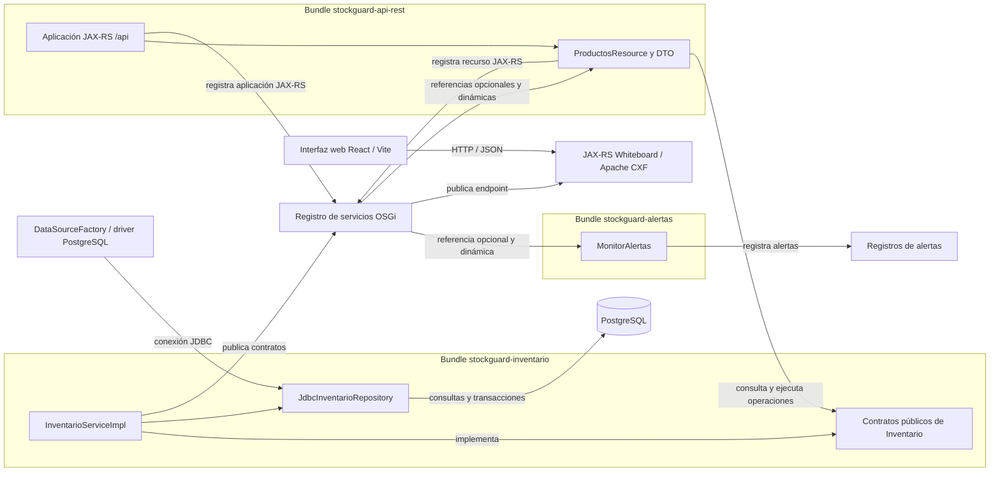

### Comunicación entre componentes

Los bundles se ejecutan dentro de la misma instancia de Apache Karaf y comparten la JVM. Inventario publica sus contratos mediante el registro de servicios OSGi. Alertas y REST consumen esos contratos sin depender directamente de las clases internas de Inventario.

Las referencias a Inventario son opcionales y dinámicas:

- **Opcionales (`OPTIONAL`):** permiten que Alertas y REST se activen aunque Inventario todavía no esté disponible.
- **Dinámicas (`DYNAMIC`):** permiten que Declarative Services asocie o retire la referencia mientras los componentes siguen activos.

El bundle REST publica una aplicación JAX-RS con base `/api`. Apache Aries JAX-RS Whiteboard descubre la aplicación y el recurso registrados como servicios OSGi y los conecta con Apache CXF y el servidor HTTP de Karaf. La implementación utiliza JAX-RS 2.1 (`javax.ws.rs`), compatible con el runtime configurado de Karaf 4.4.12.

El proveedor Jackson registra la lectura y escritura JSON para la aplicación `stockguard`. Los DTO REST separan la representación HTTP de los contratos públicos del dominio.

### Decisiones de arquitectura

La separación en bundles permite mantener responsabilidades diferenciadas:

- Inventario concentra las reglas de existencias y la persistencia.
- Alertas supervisa el inventario sin modificar sus reglas.
- REST adapta los contratos de Inventario al protocolo HTTP.

Se utiliza OSGi porque permite registrar y descubrir servicios por contrato, además de administrar el ciclo de vida de los módulos dentro de Karaf. Declarative Services gestiona las dependencias entre componentes a partir de los metadatos generados durante la compilación.

Esta solución es modular, pero no distribuida: los bundles comparten el mismo proceso de Karaf. No existe escalado independiente por módulo ni tolerancia a la caída completa del contenedor. Tampoco se utiliza JMS ni un broker de mensajería; la comunicación entre los módulos de aplicación se realiza mediante el registro de servicios OSGi.

## Módulos del sistema

### 1. Bundle de Inventario

El bundle `stockguard-inventario` implementa la lógica principal del sistema.

| Componente | Responsabilidad |
|---|---|
| `Producto` | Representa un producto con código, nombre y cantidad disponible. |
| `InventarioService` | Contrato público para listar productos y actualizar existencias. |
| `InventarioMovimientosService` | Contrato público para registrar entradas y salidas. |
| `InventarioConsultaService` | Contrato público para buscar productos y consultar movimientos. |
| `MovimientoInventario` y `TipoMovimiento` | Representan los movimientos registrados. |
| `InventarioServiceImpl` | Implementa los servicios y coordina la persistencia. |
| `JdbcInventarioRepository` | Ejecuta las consultas y transacciones JDBC. |

El paquete `com.stockguard.inventario.api` contiene los contratos públicos. El paquete `com.stockguard.inventario.internal` contiene la implementación privada.

Al activarse, el componente crea las tablas si no existen e inserta el catálogo inicial mediante `ON CONFLICT DO NOTHING`. Por eso, reiniciar Karaf no duplica los productos ni restablece cantidades que ya fueron modificadas.

Las entradas y salidas actualizan la existencia y registran el movimiento dentro de una misma transacción. Una salida no puede dejar el inventario en un valor negativo.

### 2. Bundle de Alertas

El bundle `stockguard-alertas` contiene `MonitorAlertas`, un componente Declarative Services que revisa el inventario inmediatamente después de activarse y luego cada 10 segundos.

La regla de alerta es estricta:

- Si un producto tiene **menos de cinco unidades**, se registra una alerta `WARN`.
- Si el producto permanece bajo el umbral, no se repite la alerta en cada revisión.
- Cuando vuelve a tener **cinco unidades o más**, se registra una notificación de recuperación `INFO`.
- Si posteriormente vuelve a bajar de cinco unidades, comienza un nuevo ciclo de alerta.

El monitor conserva en memoria los códigos que tienen una alerta activa. Si Inventario deja de estar disponible, el monitor permanece activo y espera la reconexión. La desconexión no se interpreta como una recuperación.

### 3. Bundle de API REST

El bundle `stockguard-api-rest` expone los servicios de Inventario mediante HTTP.

| Componente | Responsabilidad |
|---|---|
| `StockGuardApplication` | Registra la aplicación JAX-RS con base `/api`. |
| `ProductosResource` | Expone los endpoints de productos y movimientos. |
| `StockGuardJsonProvider` | Registra Jackson como proveedor de lectura y escritura JSON. |
| `RestExceptionMapper` | Convierte excepciones en respuestas HTTP controladas. |
| DTO | Define los objetos JSON de entrada y salida. |

Los DTO principales son `ProductoDto`, `MovimientoDto`, `CantidadRequest` y `ErrorDto`.

REST no accede directamente a PostgreSQL ni ejecuta SQL. Cuando Inventario no está disponible, las operaciones que dependen de ese servicio responden `503 Service Unavailable`.

## Persistencia y catálogo inicial

PostgreSQL almacena los productos y el historial de movimientos. La implementación JDBC utiliza un `DataSource` obtenido mediante el servicio OSGi `DataSourceFactory`.

El esquema contiene dos tablas principales:

| Tabla | Descripción |
|---|---|
| `productos` | Almacena el código, nombre, cantidad disponible y fechas de creación y actualización. El código es la clave primaria y la cantidad no puede ser negativa. |
| `movimientos_inventario` | Almacena el identificador, producto, tipo de movimiento, cantidad modificada, existencia anterior y posterior, fecha y observación opcional. |

Las operaciones de actualización utilizan transacciones y bloqueo de fila (`SELECT ... FOR UPDATE`). La modificación de existencias y el registro del movimiento se confirman juntos o se revierten juntos si ocurre un error.

### Productos de demostración

El catálogo se inicializa con los siguientes 15 productos:

| Código | Producto | Existencias iniciales |
|---|---|---:|
| P-001 | Teclado mecánico Logitech | 12 |
| P-002 | Mouse inalámbrico Logitech | 3 |
| P-003 | Monitor Samsung 24 pulgadas | 8 |
| P-004 | Cable HDMI 2 metros | 1 |
| P-005 | Memoria RAM Kingston 16 GB | 20 |
| P-006 | SSD Kingston 1 TB | 14 |
| P-007 | Audífonos HyperX Cloud | 4 |
| P-008 | Webcam Logitech C920 | 7 |
| P-009 | Adaptador USB-C | 2 |
| P-010 | Hub USB 3.0 | 18 |
| P-011 | Disco duro externo 2 TB | 6 |
| P-012 | Router TP-Link Wi-Fi 6 | 9 |
| P-013 | Fuente de poder 650 W | 11 |
| P-014 | Pasta térmica Arctic MX-4 | 25 |
| P-015 | Soporte para laptop | 5 |

Los productos que comienzan por debajo del umbral son P-002, P-004, P-007 y P-009. P-015 tiene exactamente cinco unidades, por lo que no genera una alerta.

## API REST

La API utiliza la base `http://localhost:8181/api` en la configuración local predeterminada de Karaf.

Las respuestas que contienen datos utilizan JSON. Las operaciones POST aceptadas responden `204 No Content`, por lo que no devuelven un cuerpo de respuesta.

### Endpoints disponibles

| Método | Ruta | Descripción | Respuesta principal |
|---|---|---|---|
| `GET` | `/api/productos` | Lista los productos ordenados por código. | `200 OK` |
| `GET` | `/api/productos/{codigo}` | Consulta el detalle de un producto. | `200 OK`; `404` si no existe. |
| `POST` | `/api/productos/{codigo}/entradas` | Registra una entrada de unidades. | `204 No Content` |
| `POST` | `/api/productos/{codigo}/salidas` | Registra una salida de unidades. | `204 No Content`; `409` si supera el stock. |
| `POST` | `/api/productos/{codigo}/ajustes` | Establece la cantidad disponible, incluido cero. | `204 No Content` |
| `GET` | `/api/productos/{codigo}/movimientos` | Consulta el historial del producto, del más reciente al más antiguo. | `200 OK` |

Las operaciones de entrada y salida reciben un cuerpo JSON con una cantidad positiva:

```json
{
  "cantidad": 5
}
```

Un ajuste establece la existencia final solicitada y admite cero, pero no cantidades negativas.

### Códigos HTTP utilizados

| Código | Significado |
|---|---|
| `200 OK` | Consulta realizada correctamente. |
| `204 No Content` | Operación de escritura aceptada. |
| `400 Bad Request` | Código, formato JSON o cantidad inválida. |
| `404 Not Found` | El producto solicitado no existe. |
| `409 Conflict` | La salida solicitada supera las existencias disponibles. |
| `503 Service Unavailable` | Inventario o su almacenamiento no están disponibles. |
| `500 Internal Server Error` | Error no previsto. Se devuelve un mensaje genérico y los detalles se registran en Karaf. |

La API no incorpora autenticación ni una configuración CORS específica. Está pensada para el entorno local de demostración.

### Ejemplo de consulta desde PowerShell

```powershell
$base = "http://localhost:8181/api"

$productos = Invoke-RestMethod -Uri "$base/productos" -Method Get
$productos | ConvertTo-Json -Depth 5

Invoke-RestMethod -Uri "$base/productos/P-001" -Method Get
Invoke-RestMethod -Uri "$base/productos/P-001/movimientos" -Method Get
```

> Las solicitudes POST modifican existencias. Para probarlas, utiliza una base de desarrollo y verifica el producto antes y después de cada operación.

## Interfaz web

El directorio `stockguard-frontend` contiene una aplicación de una sola página desarrollada con React y TypeScript. La interfaz consume la API REST y no se conecta directamente a PostgreSQL.

La interfaz incluye:

- Panel general con indicadores del inventario.
- Catálogo con búsqueda, filtros y ordenamiento.
- Detalle de producto e historial de movimientos.
- Formularios para registrar entradas, salidas y ajustes.
- Vista de productos con existencias inferiores al umbral.

La vista de alertas consulta el inventario actual. El historial de alertas del monitor se conserva en los registros de Karaf.

En desarrollo, Vite utiliza un proxy para reenviar las solicitudes `/api` al servidor Karaf en `http://localhost:8181`. El destino puede cambiarse mediante `STOCKGUARD_PROXY_TARGET` en la configuración local del frontend.

### Demostración de operaciones reales

La revisión visual se realizó en Chrome con la interfaz conectada a la API REST local. Se utilizaron datos del inventario persistido, sin mocks.

El producto P-002 comenzó con **3 unidades**. Desde la interfaz se realizaron estas operaciones:

1. Se registró una entrada de 3 unidades: la existencia pasó de 3 a 6.
2. Con 6 unidades, P-002 dejó de aparecer entre los productos con stock bajo.
3. Se registró una salida de 3 unidades: la existencia volvió de 6 a 3.
4. P-002 volvió a aparecer en la vista de alertas.
5. La consulta final confirmó 3 unidades y exactamente dos movimientos: una entrada y una salida.

La cantidad final quedó igual a la inicial. No se modificaron otros productos durante esta demostración.

### Panel general

El panel presenta los indicadores generales del inventario consultado desde el backend.

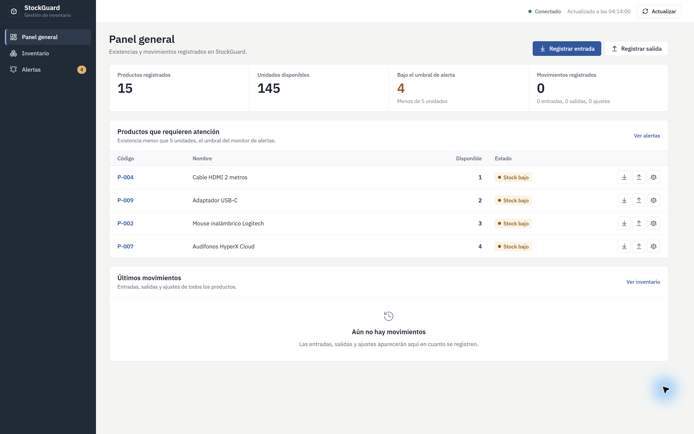

### Catálogo, búsqueda y filtros

Se comprobó la visualización de los 15 productos, la búsqueda por nombre y el filtro de stock bajo. La búsqueda «Mo» mostró tres coincidencias y, al aplicar el filtro de stock bajo, quedó P-002.

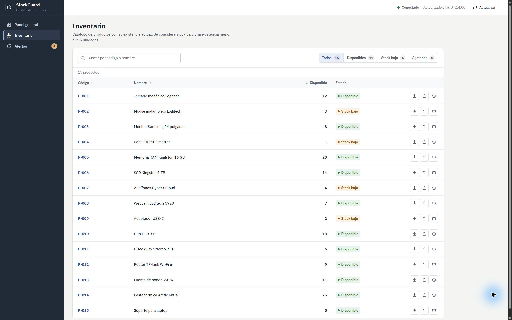

### Detalle del producto

El detalle de P-002 muestra sus existencias, el umbral de stock bajo y las acciones disponibles.

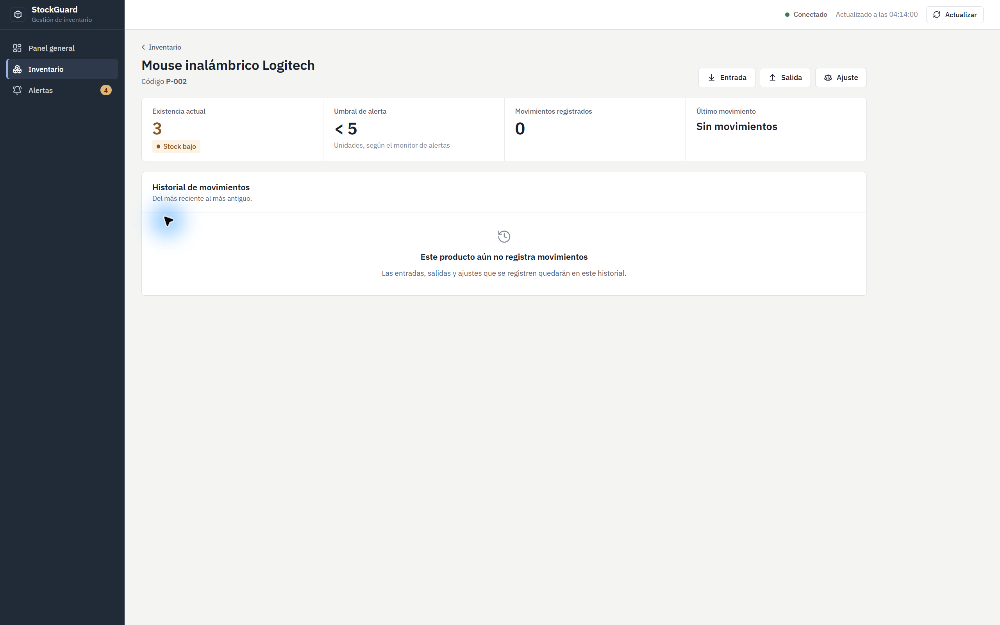

### Registro de entrada

El diálogo muestra la operación antes de confirmarla: agregar tres unidades a P-002, que pasa de 3 a 6.

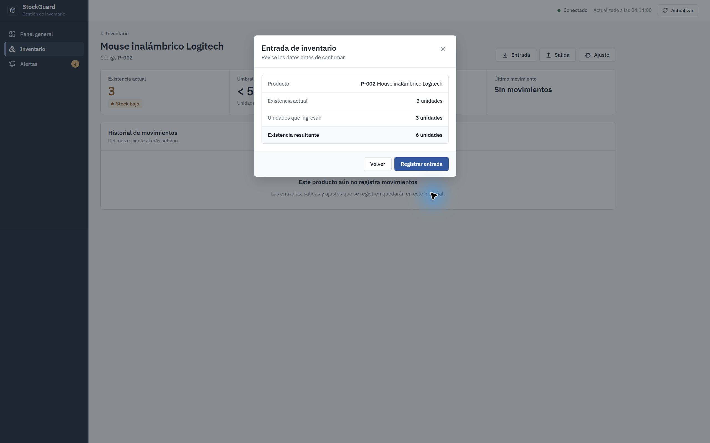

Después de confirmar la entrada, la interfaz muestra seis unidades y el producto deja de estar bajo el umbral.

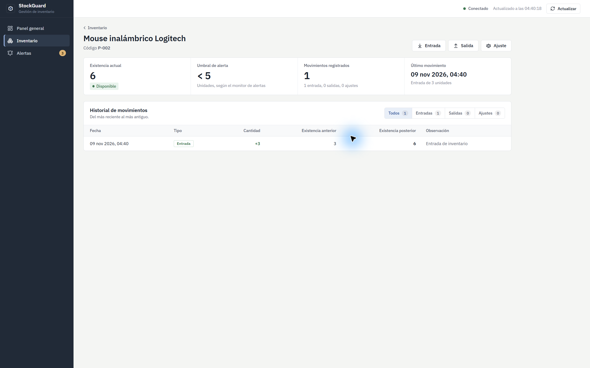

### Registro de salida

El diálogo presenta la salida de tres unidades, con una existencia prevista de 6 a 3.

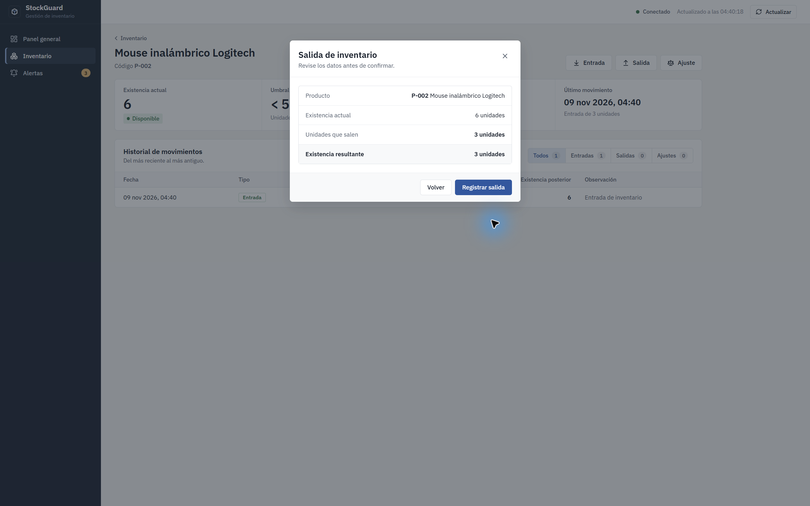

Después de confirmar la salida, P-002 vuelve a tener tres unidades y el movimiento queda registrado en el historial.

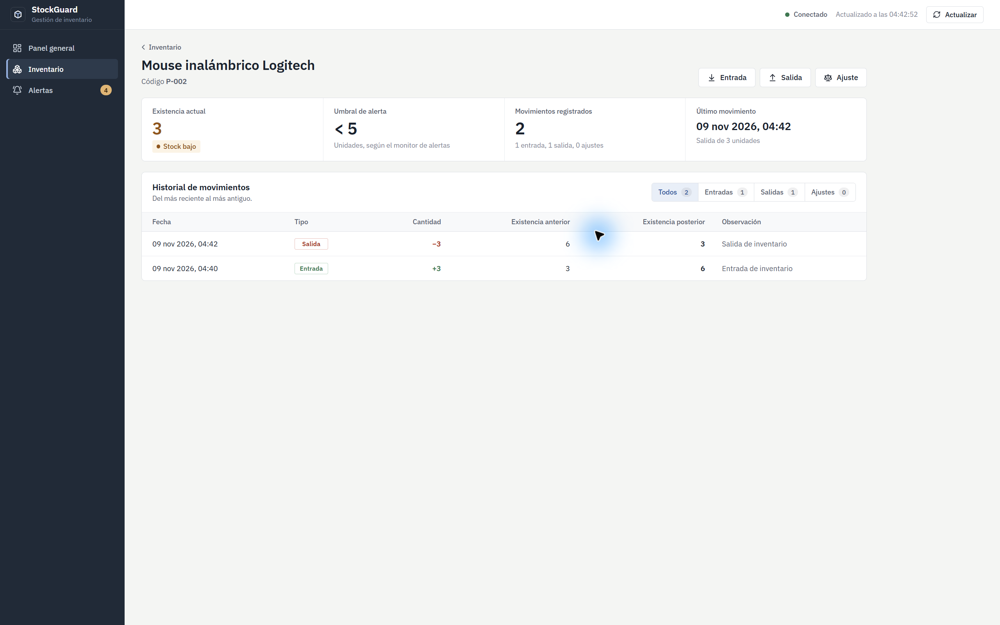

### Alertas actualizadas

Después de la salida, P-002 vuelve a estar por debajo de cinco unidades. La vista muestra los cuatro productos con stock bajo.

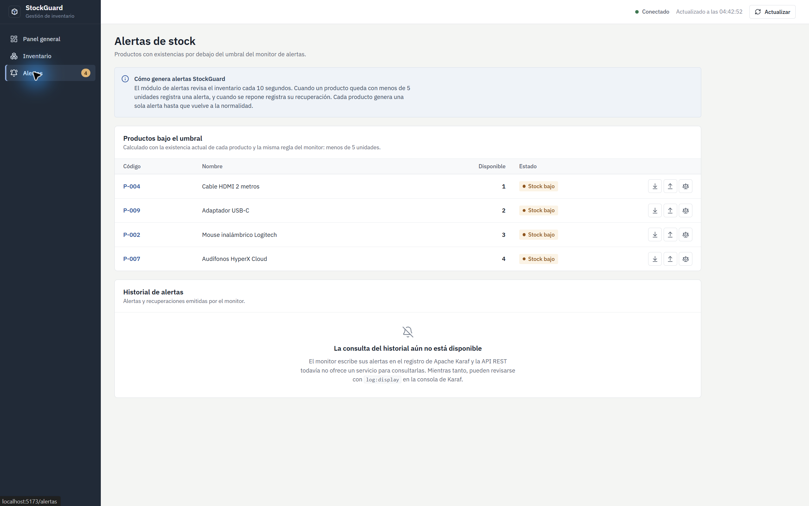

### Validaciones de la interfaz

Se comprobó que la interfaz impide continuar con cantidades cero o negativas y con una salida superior a las existencias disponibles. Estas operaciones inválidas se bloquearon en el formulario y no se enviaron al backend.

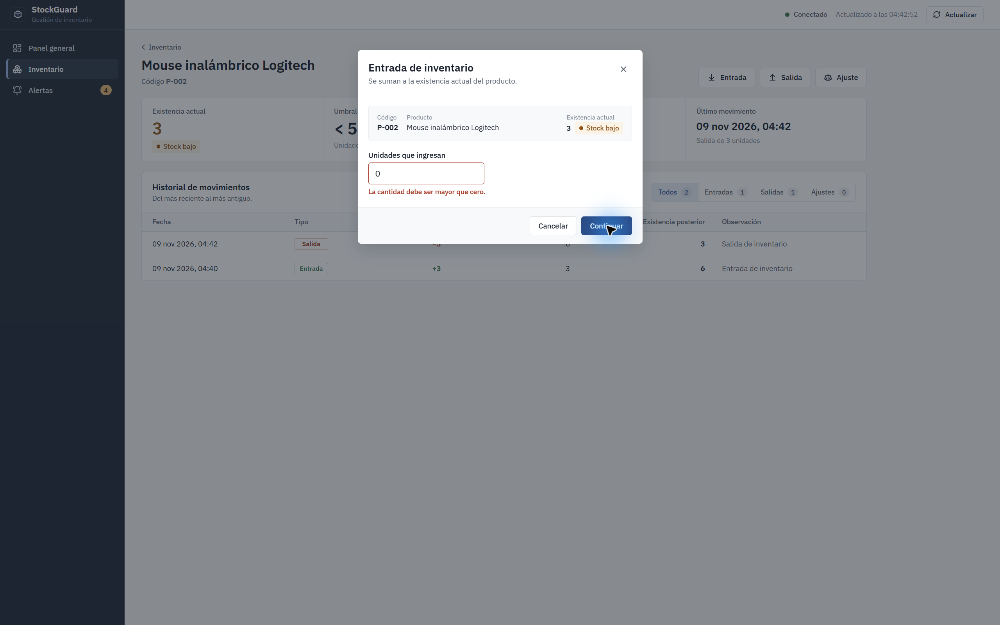

### Historial de movimientos

El historial de P-002 muestra los dos movimientos realizados: entrada de 3 unidades (3 → 6) y salida de 3 unidades (6 → 3). También se comprobaron los filtros de entradas y salidas.

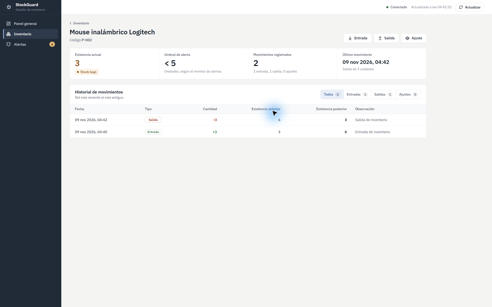

Durante la revisión en Chrome no se observaron errores JavaScript. DevTools mostró una advertencia de accesibilidad relacionada con un campo sin atributo `id` o `name`; no impidió las operaciones comprobadas y queda como una mejora menor de la interfaz.

## Requisitos previos

Para ejecutar el proyecto localmente se necesitan:

- JDK 17.
- Maven compatible con los plugins declarados en los POM del proyecto.
- Apache Karaf 4.4.12.
- Docker Desktop con Docker Compose.
- Node.js 22.12 o posterior y npm.
- Git.

PostgreSQL 16 se ejecuta mediante Docker Compose, por lo que no es necesario instalar el servidor directamente en Windows.

## Instalación y ejecución

Los siguientes pasos describen el entorno local de desarrollo en Windows y PowerShell.

### 1. Descargar el proyecto y preparar las variables

Abre PowerShell en el directorio raíz del proyecto. Cuando el repositorio esté publicado en GitHub, podrás clonar esa misma carpeta desde la URL que se genere para el repositorio.

Crea el archivo local de variables si todavía no existe:

```powershell
if (-not (Test-Path .env)) {
    Copy-Item .env.example .env
}
notepad .env
```

Edita `.env` y reemplaza los valores de ejemplo por los datos locales que utilizarás. No subas este archivo a GitHub: contiene configuración privada y está excluido mediante `.gitignore`.

### 2. Iniciar PostgreSQL

Desde la raíz del proyecto:

```powershell
docker compose up -d postgres
docker compose ps
Test-NetConnection -ComputerName localhost -Port 5437
```

El servicio publica PostgreSQL en `localhost:5437` y utiliza el puerto interno `5432` dentro de Docker. El volumen `stockguard-postgres-data` conserva los datos entre reinicios.

Para detener únicamente el servicio:

```powershell
docker compose stop postgres
```

Para iniciarlo nuevamente:

```powershell
docker compose start postgres
```

No utilices `docker compose down -v` si deseas conservar los datos, porque esa opción elimina los volúmenes.

### 3. Configurar Inventario en Karaf

El ejemplo de configuración se encuentra en `docs/configuracion/stockguard-inventario.cfg.example`.

Define `KARAF_HOME` con la ruta de tu instalación de Karaf. Si el archivo de configuración todavía no existe, cópialo:

```powershell
$configInventario = Join-Path $env:KARAF_HOME `
  "etc\com.stockguard.inventario.internal.InventarioServiceImpl.cfg"

if (-not (Test-Path $configInventario)) {
    Copy-Item .\docs\configuracion\stockguard-inventario.cfg.example $configInventario
}

notepad $configInventario
```

Configura la URL y el usuario de PostgreSQL. La contraseña debe establecerse localmente mediante `STOCKGUARD_DB_PASSWORD` o mediante Config Admin en la instalación de Karaf. No guardes contraseñas reales en el repositorio.

La conexión utilizada por Karaf ejecutado directamente en Windows es:

```text
jdbc:postgresql://localhost:5437/stockguard_db
```

### 4. Iniciar Karaf y preparar los servicios

En PowerShell:

```powershell
Set-Location $env:KARAF_HOME
.\bin\karaf.bat
```

En la consola de Karaf, comprueba la versión e instala las features necesarias si todavía no están disponibles:

```text
karaf@root()> version
karaf@root()> feature:install scr
karaf@root()> feature:install jdbc
```

El runtime también necesita las features HTTP/Whiteboard, Aries JAX-RS y Jackson utilizadas por el bundle REST. Si no están instaladas, agrega los repositorios compatibles con Karaf 4.4.12:

```text
karaf@root()> feature:repo-add mvn:org.ops4j.pax.web/pax-web-features/8.0.35/xml/features
karaf@root()> feature:repo-add mvn:org.apache.cxf.karaf/apache-cxf/3.6.12/xml/features
karaf@root()> feature:repo-add mvn:org.apache.aries.jax.rs/org.apache.aries.jax.rs.features/2.0.2/xml
```

Instala las features que no estén disponibles en el runtime:

```text
karaf@root()> feature:install http-whiteboard/8.0.35
karaf@root()> feature:install aries-jax-rs-whiteboard/2.0.2 aries-jax-rs-whiteboard-jackson/2.0.2
```

Comprueba si el driver PostgreSQL ya está instalado:

```text
karaf@root()> bundle:list
```

Si todavía no aparece, instálalo como bundle externo y verifica el servicio JDBC:

```text
karaf@root()> bundle:install -s mvn:org.postgresql/postgresql/42.7.14
karaf@root()> service:list org.osgi.service.jdbc.DataSourceFactory
```

### 5. Compilar los módulos

Abre otra ventana de PowerShell en la raíz del proyecto y ejecuta:

```powershell
mvn clean verify
```

Los JAR se generan en:

```text
stockguard-inventario/target/stockguard-inventario-1.0.0-SNAPSHOT.jar
stockguard-alertas/target/stockguard-alertas-1.0.0-SNAPSHOT.jar
stockguard-api-rest/target/stockguard-api-rest-1.0.0-SNAPSHOT.jar
```

### 6. Instalar o actualizar los bundles

En Karaf, ejecuta `bundle:list` y localiza los identificadores actuales por nombre simbólico. Los ID numéricos pueden cambiar entre instalaciones.

Para actualizar Inventario, utiliza el ID existente:

```text
karaf@root()> bundle:update <ID_INVENTARIO> 'file:///ruta/local/stockguard-inventario/target/stockguard-inventario-1.0.0-SNAPSHOT.jar'
```

Si el bundle REST todavía no está instalado, instálalo una vez:

```text
karaf@root()> bundle:install -s 'file:///ruta/local/stockguard-api-rest/target/stockguard-api-rest-1.0.0-SNAPSHOT.jar'
```

Si ya existe, actualiza el bundle REST utilizando su ID actual:

```text
karaf@root()> bundle:update <ID_API_REST> 'file:///ruta/local/stockguard-api-rest/target/stockguard-api-rest-1.0.0-SNAPSHOT.jar'
```

No instales copias adicionales de bundles que ya existen. Si Alertas no ha cambiado, no es necesario actualizarlo.

### 7. Comprobar los bundles y la API

En Karaf:

```text
karaf@root()> bundle:list
karaf@root()> service:list com.stockguard.inventario.api.InventarioService
karaf@root()> service:list com.stockguard.inventario.api.InventarioMovimientosService
karaf@root()> service:list com.stockguard.inventario.api.InventarioConsultaService
karaf@root()> log:display
```

Los tres bundles de aplicación deben aparecer como `Active` cuando el entorno está correctamente configurado y PostgreSQL está disponible.

Desde PowerShell:

```powershell
Invoke-RestMethod -Uri "http://localhost:8181/api/productos" -Method Get
Invoke-RestMethod -Uri "http://localhost:8181/api/productos/P-001" -Method Get
```

La primera consulta debe devolver el catálogo de 15 productos.

### 8. Iniciar el frontend

Con Karaf y la API REST activos, abre otra ventana de PowerShell:

```powershell
Set-Location .\stockguard-frontend
npm ci
npm run dev
```

Vite mostrará la dirección local de desarrollo, normalmente:

```text
http://localhost:5173
```

Para ejecutar las comprobaciones del frontend:

```powershell
npm test
npm run build
npm run lint
```

## Pruebas y resultados

### Pruebas automatizadas del backend

La ejecución registrada de `mvn clean verify` finalizó con `BUILD SUCCESS` y **96 pruebas aprobadas**, distribuidas de la siguiente manera:

| Módulo | Pruebas |
|---|---:|
| Inventario | 21 |
| Alertas | 16 |
| API REST | 59 |
| **Total** | **96** |

Inventario utiliza Testcontainers para ejecutar pruebas de integración contra PostgreSQL real. Alertas y REST utilizan Mockito para controlar los contratos de Inventario. REST también ejecuta pruebas HTTP con un servidor CXF embebido; este servidor de pruebas no es una instancia de Karaf.

Las pruebas cubren, entre otros aspectos:

- Inicialización idempotente del catálogo.
- Consultas, entradas, salidas y ajustes.
- Registro de movimientos y transacciones.
- Validaciones y rollback ante errores.
- Concurrencia en las actualizaciones.
- Umbral de alertas, deduplicación y recuperación.
- Desconexión y reconexión del servicio de Inventario.
- Conversión JSON, códigos HTTP y manejo de errores REST.

### Pruebas automatizadas del frontend

La ejecución registrada del frontend finalizó correctamente:

- **72 pruebas aprobadas en 7 archivos.**
- `npm run build`: correcto.
- `npm run lint`: correcto.

### Pruebas manuales de API

En una ejecución manual documentada se comprobó el siguiente flujo para P-001:

| Operación | Existencia anterior | Cantidad | Existencia posterior |
|---|---:|---:|---:|
| Entrada | 12 | +5 | 17 |
| Salida | 17 | −2 | 15 |
| Ajuste | 15 | 20 como cantidad final | 20 |

También se documentaron las respuestas de validación:

- Cantidad cero en una entrada: `400 Bad Request`.
- Producto inexistente P-999: `404 Not Found`.
- Salida de 25 unidades cuando había 20: `409 Conflict`; las existencias permanecieron en 20 y no se agregó un movimiento.

Estas pruebas manuales se distinguen de las pruebas automatizadas y de la demostración visual del frontend.

### Pruebas manuales del frontend

En Chrome se recorrieron el panel general, el catálogo, el detalle de producto, el historial, las alertas y los formularios de entrada, salida y ajuste.

La demostración de P-002 confirmó las transiciones 3 → 6 → 3 y la actualización de la vista de stock bajo. Las validaciones de cero, cantidades negativas y salidas superiores a las existencias bloquearon la continuación desde la interfaz; no se enviaron esas operaciones inválidas al backend.

## Evidencias de funcionamiento

Las capturas siguientes documentan el backend, el runtime OSGi, la API REST y las pruebas visuales del frontend. Las capturas 01–10 se conservan en el directorio como registro de etapas anteriores del desarrollo; no se utilizan como evidencia principal del estado final.

### Backend, OSGi y API REST

**Validación de JSON.** La API rechaza solicitudes con cuerpos JSON o cantidades inválidas y responde con HTTP 400.

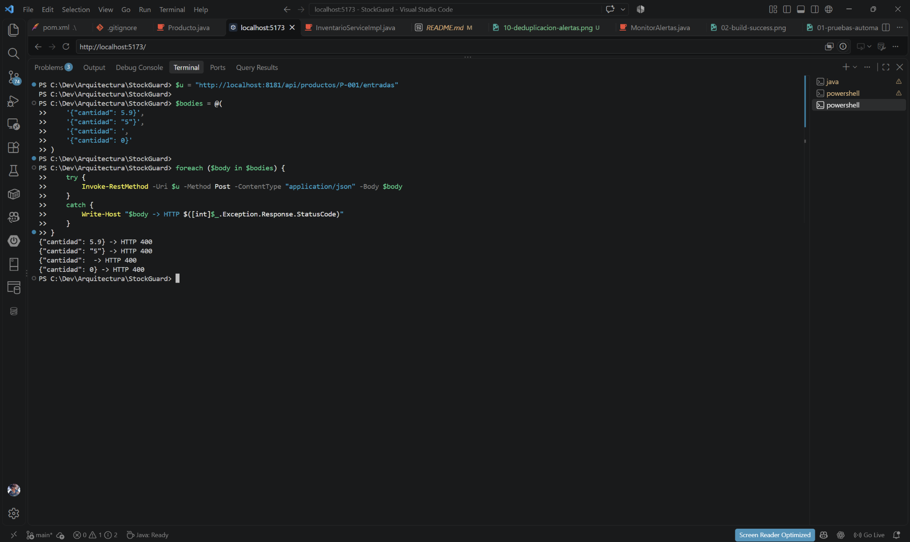

**Proveedor JSON.** El proveedor Jackson aparece registrado como lector y escritor JSON y asociado a la aplicación StockGuard.

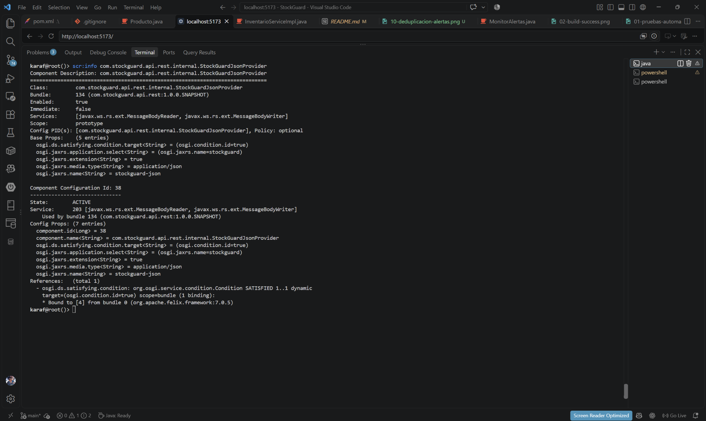

**Consulta REST e historial.** Se muestra la consulta del producto P-001 y sus movimientos.

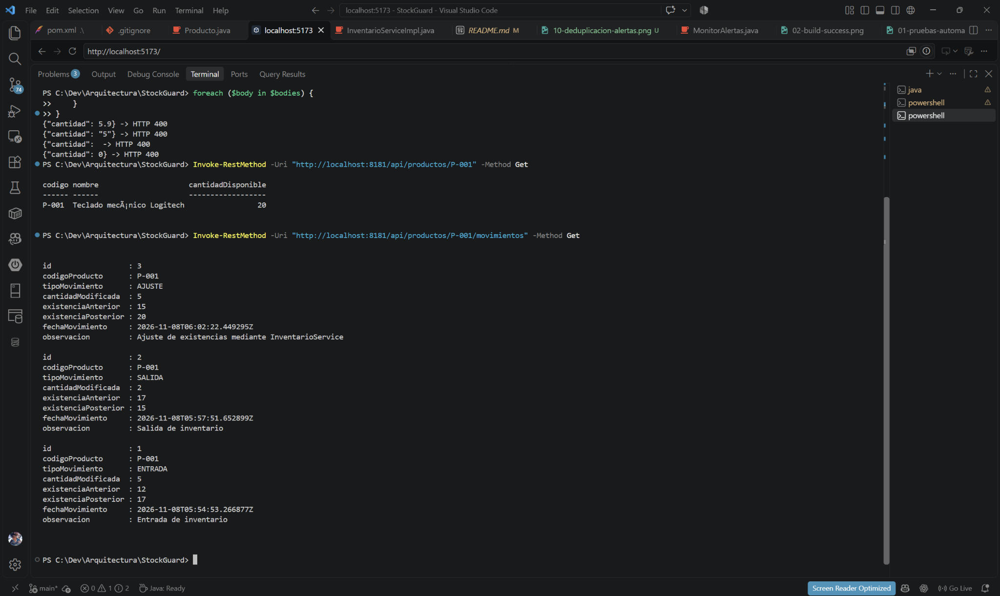

**Ciclo de vida de Alertas.** La captura muestra el bundle Alertas detenido mientras Inventario y API REST permanecen activos.

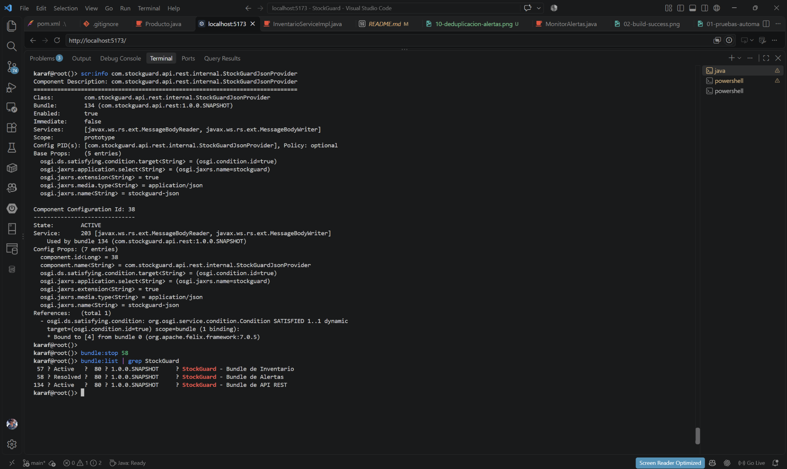

**Bundles activos.** Después de iniciar Alertas, los tres bundles de aplicación aparecen activos.

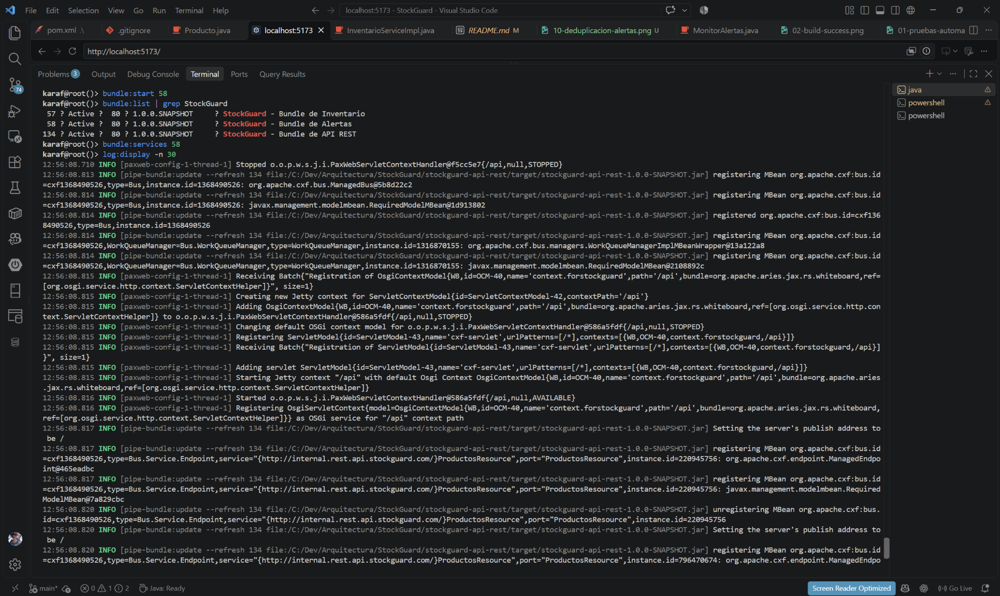

**Catálogo REST.** La API devuelve los quince productos del inventario.

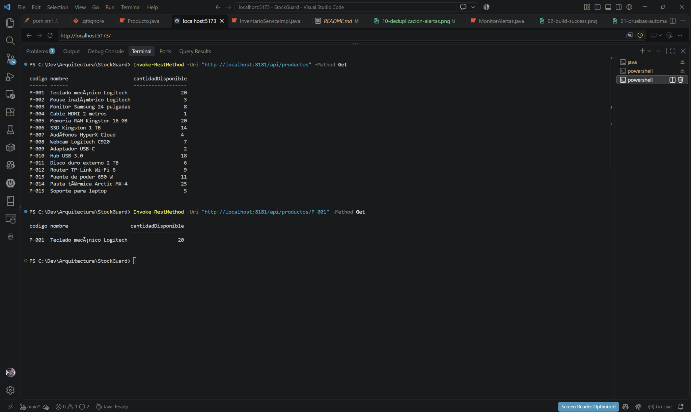

**Indisponibilidad de Inventario.** Al detener Inventario, la API responde HTTP 503 para las operaciones que dependen de ese servicio.

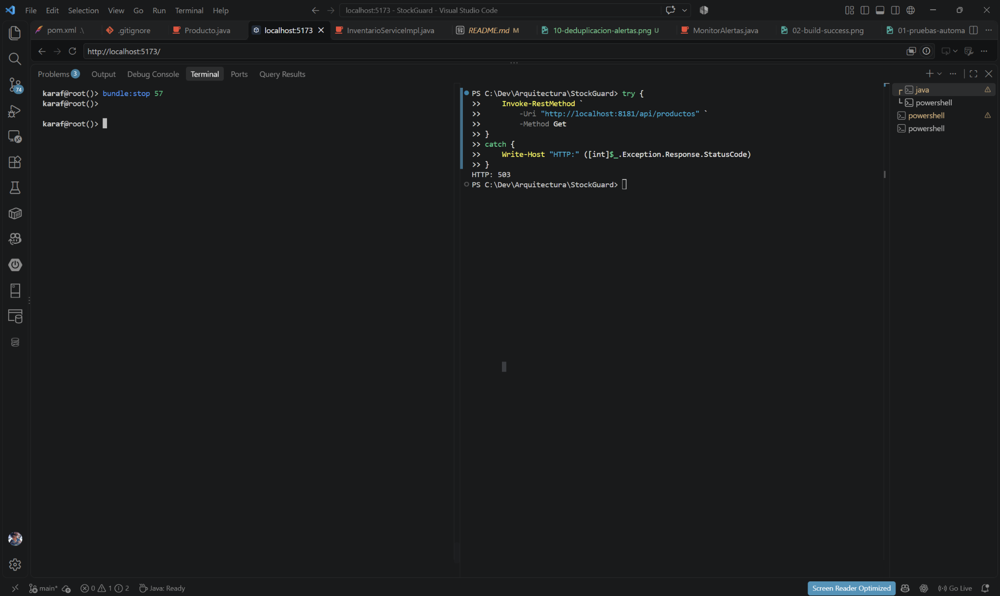

**Recuperación del servicio.** Después de iniciar Inventario, una consulta REST vuelve a responder HTTP 200.

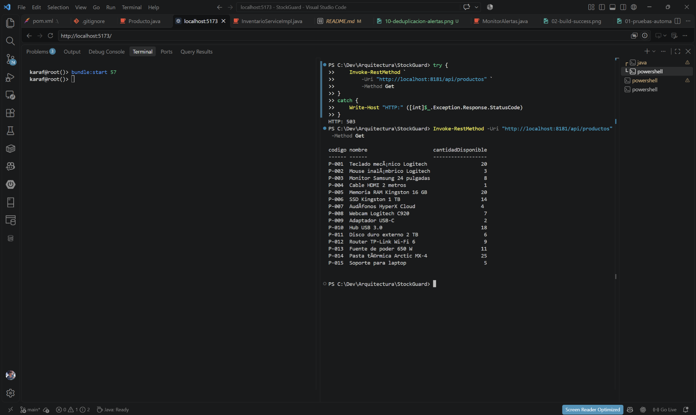

Las capturas 19–28 del frontend se presentan en la sección [Interfaz web](#interfaz-web), junto con la explicación de cada prueba.
## Comportamiento ante fallos

| Situación | Comportamiento |
|---|---|
| PostgreSQL no está disponible al activar Inventario | El componente no publica sus servicios y registra el error. No utiliza almacenamiento en memoria como sustituto. |
| Falla una operación de persistencia | La operación se revierte y la API informa que el servicio no está disponible. |
| Inventario deja de publicar sus servicios | Alertas permanece activo y espera la reconexión. REST continúa publicado, pero las operaciones que necesitan Inventario responden `503`. |
| Inventario vuelve a estar disponible | Declarative Services vuelve a asociar las referencias y los consumidores pueden utilizar los servicios nuevamente. |
| Karaf se detiene por completo | Los bundles dejan de ejecutarse porque comparten el mismo proceso. |
| Un producto permanece bajo el umbral | El monitor evita repetir la alerta en cada ciclo mientras siga activa. |

Los estados de alertas activas se conservan en memoria, no en PostgreSQL. Si se inicia una nueva JVM de Karaf, el monitor vuelve a revisar los productos y puede registrar nuevamente las alertas que continúen bajo el umbral.

## Limitaciones y mejoras futuras

El alcance actual del proyecto tiene las siguientes limitaciones:

- PostgreSQL debe estar disponible y configurado para que Inventario se active. No existe persistencia alternativa en memoria.
- El catálogo inicial agrega productos que no existen; no se implementan operaciones para crear, eliminar o cambiar el nombre de productos desde la interfaz.
- El frontend se ejecuta como una aplicación Vite independiente y no se empaqueta ni se publica desde Karaf.
- La API REST no incorpora autenticación ni una configuración CORS específica.
- El historial de movimientos se persiste en PostgreSQL, pero el estado activo de las alertas se mantiene en memoria.
- No se implementa mensajería JMS ni integración con Apache Artemis; la comunicación interna utiliza servicios OSGi.

Como mejoras futuras se podrían incorporar autenticación y autorización, administración completa de productos, configuración del umbral de alertas, persistencia del historial de alertas y un mecanismo de despliegue integrado para la interfaz web.

## Estructura del proyecto

```text
StockGuard/
├── README.md
├── pom.xml
├── .gitignore
├── .env.example
├── docker-compose.yml
├── docs/
│   ├── configuracion/
│   │   └── stockguard-inventario.cfg.example
│   └── capturas/
├── stockguard-inventario/
│   ├── pom.xml
│   └── src/
│       ├── main/
│       │   ├── java/com/stockguard/inventario/
│       │   │   ├── api/
│       │   │   └── internal/
│       │   └── resources/db/schema.sql
│       └── test/
├── stockguard-alertas/
│   ├── pom.xml
│   └── src/
│       ├── main/java/com/stockguard/alertas/internal/
│       └── test/
├── stockguard-api-rest/
│   ├── pom.xml
│   └── src/
│       ├── main/java/com/stockguard/api/rest/internal/
│       │   └── dto/
│       └── test/
└── stockguard-frontend/
    ├── .env.example
    ├── package.json
    ├── package-lock.json
    ├── vite.config.ts
    └── src/
        ├── api/
        ├── components/
        ├── context/
        ├── domain/
        ├── hooks/
        ├── layout/
        ├── pages/
        ├── styles/
        └── test/
```

El paquete `com.stockguard.inventario.api` define el contrato público entre bundles. Los paquetes `internal` contienen implementaciones privadas. Los DTO REST representan los datos intercambiados por HTTP y no forman parte del contrato OSGi de Inventario. Los directorios `target/`, `node_modules/` y `dist/` se generan localmente y no forman parte del código fuente que debe versionarse.

## Conclusiones

StockGuard integra un backend Java modular basado en OSGi, persistencia relacional con PostgreSQL, monitoreo de existencias y una API REST consumida por una interfaz web. La separación en bundles permite administrar los componentes mediante Apache Karaf y conectar sus servicios mediante Declarative Services.

El proyecto demuestra la consulta y actualización transaccional de existencias, el registro de movimientos, la generación de alertas sin duplicación por ciclo y el comportamiento ante la desconexión de un servicio. Las pruebas automatizadas y las verificaciones manuales documentadas aportan evidencia de estos comportamientos.

La solución mantiene un alcance de demostración: los módulos comparten el mismo contenedor Karaf, el frontend se despliega por separado y no se incorporan autenticación, JMS ni un broker de mensajería. Estas decisiones y limitaciones quedan identificadas para distinguir las funcionalidades implementadas de las posibles ampliaciones.
