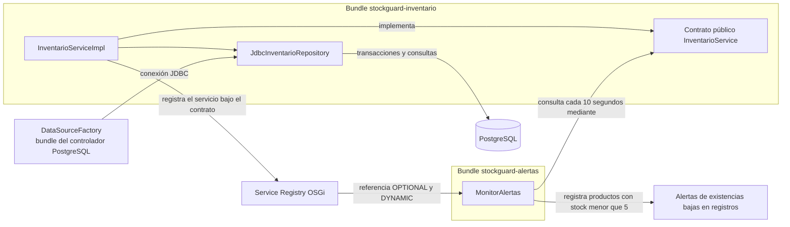

# StockGuard — Sistema Modular de Inventario

StockGuard es una aplicación de servidor de demostración para controlar el inventario de una pequeña tienda de tecnología y accesorios de computación. Persiste productos y movimientos en PostgreSQL, y registra alertas en los logs cuando la disponibilidad cae por debajo de cinco unidades.

El proyecto sirve como ejemplo de una aplicación Java modular ejecutada en Apache Karaf. Sus dos bundles OSGi pueden gestionar su ciclo de vida por separado, mientras que el bundle de alertas descubre el servicio de inventario mediante el registro de servicios de OSGi.

## Funcionalidad

- Inicializar 15 productos de demostración en PostgreSQL sin duplicarlos ni sobrescribir existencias existentes.
- Consultar productos ordenados por código, ajustar existencias y registrar entradas y salidas.
- Revisar las existencias cada 10 segundos.
- Registrar una alerta cuando un producto tiene menos de cinco unidades.
- Mantener el monitor activo si Inventario deja de estar disponible y reconectarlo cuando el servicio vuelve.

## Arquitectura

StockGuard está dividido en dos bundles de aplicación: `stockguard-inventario` contiene el contrato y la implementación del inventario; `stockguard-alertas` contiene el monitor que consulta ese contrato. El proyecto Maven de la raíz solo coordina la compilación de ambos módulos (`packaging=pom`), por lo que no genera un tercer bundle de aplicación.

OSGi permite instalar, resolver, iniciar, detener y actualizar módulos dentro de un mismo entorno de ejecución. Para este ejemplo, la separación hace visible el ciclo de vida independiente entre quien ofrece los datos y quien los supervisa. PostgreSQL se integra mediante JDBC estándar de OSGi y un controlador PostgreSQL instalado como bundle de infraestructura de terceros; no se agrega un tercer bundle de aplicación. No se trata de una arquitectura de microservicios distribuidos: los bundles se ejecutan en el mismo contenedor Karaf y la comunicación entre ellos ocurre mediante servicios OSGi.

### Registro de servicios y Declarative Services

El bundle de Inventario implementa `InventarioService` y `InventarioMovimientosService`; Declarative Services (DS) publica ambos contratos en el registro OSGi. El registro asocia los servicios con sus interfaces públicas; otros componentes pueden solicitar una referencia sin depender de la clase concreta. Para acceder a PostgreSQL, Inventario consume `org.osgi.service.jdbc.DataSourceFactory`, que proporciona el bundle OSGi del controlador.

`MonitorAlertas` declara con anotaciones DS una referencia de cardinalidad `OPTIONAL` y política `DYNAMIC`. `OPTIONAL` permite que Alertas se active aunque Inventario no esté disponible. `DYNAMIC` permite que DS notifique la llegada o retirada del servicio durante la vida del componente, sin exigir que Alertas se detenga y vuelva a iniciar. El monitor consulta el servicio cuando tiene una referencia y espera la reconexión cuando no la tiene.

DS procesa las anotaciones de componentes y referencias durante la construcción del bundle y genera los descriptores de componentes OSGi. El componente de Inventario requiere configuración externa y el servicio JDBC. Si falta el controlador, la configuración, las credenciales o la base de datos, el componente no se activa ni publica servicios y registra el error; no sustituye PostgreSQL por almacenamiento en memoria. El registro administra las referencias; no se incorpora un localizador propio.

### Metadatos OSGi generados

El manifiesto de Inventario identifica el bundle como `com.stockguard.inventario`, exporta `com.stockguard.inventario.api` con versión `1.1.0` y declara ambos servicios de inventario. Importa la API JDBC OSGi en alcance `provided`; el controlador no se incrusta en el JAR. Alertas importa la API de Inventario dentro del rango `[1.0,2)`. Los descriptores DS se empaquetan bajo `OSGI-INF/`: Alertas conserva su referencia `0..1` y `dynamic`, mientras que Inventario declara el requisito de `DataSourceFactory` y la configuración obligatoria.

### Diagrama de componentes



Inventario publica sus contratos solo después de conectarse a PostgreSQL e inicializar el esquema. El repositorio ejecuta las consultas y transacciones; Alertas obtiene una referencia dinámica a `InventarioService`, consulta el catálogo y registra una alerta por cada transición que cumple el umbral.

### Bundle de Inventario

| Elemento | Responsabilidad |
|---|---|
| `Producto` | Registro de Java (`record`) con código, nombre y cantidad disponible. |
| `InventarioService` | API pública existente para listar productos y actualizar existencias. |
| `InventarioMovimientosService` | API pública complementaria para registrar entradas y salidas. |
| `InventarioServiceImpl` | Valida la configuración, inicializa el catálogo sin sobrescribir datos y publica los servicios mediante DS. |
| `JdbcInventarioRepository` | Implementación interna JDBC con operaciones transaccionales y bloqueo de fila al cambiar existencias. |

Los productos se guardan en PostgreSQL. Al activarse, el componente crea las tablas si no existen e inserta los 15 productos con `ON CONFLICT DO NOTHING`: reiniciar Karaf no duplica el catálogo ni repone cantidades que ya se cambiaron. `listarProductos()` devuelve la lista ordenada por código. `actualizarExistencias()` conserva el código y nombre y registra un movimiento `AJUSTE` cuando cambia la cantidad; una cantidad negativa se rechaza y un código desconocido devuelve `false`. Las operaciones de entrada y salida registran sus movimientos dentro de la misma transacción que actualiza el producto.

El POM de Inventario exporta `com.stockguard.inventario.api` como paquete público. `com.stockguard.inventario.internal` es implementación privada y no forma parte del contrato que consumen otros bundles. La interfaz `InventarioService` y el record `Producto` conservan su contrato; las operaciones de movimientos se exponen en la interfaz complementaria.

### Bundle de Alertas

`MonitorAlertas` es un componente inmediato de DS. Al activarse crea un programador de una sola hebra y ejecuta la consulta de inmediato y luego cada 10 segundos. La comparación es estricta: cinco unidades no generan alerta.

El monitor mantiene en memoria los códigos que ya tienen una alerta activa. Cuando un producto pasa de cinco o más unidades a menos de cinco, registra un único mensaje `WARN` con el prefijo `ALERTA:`. Las revisiones posteriores no repiten la notificación mientras el producto continúe bajo el umbral. Al observar cinco o más unidades, elimina el estado activo y registra una sola notificación `INFO` con el prefijo `RECUPERACIÓN:` y la cantidad disponible. Si vuelve a caer por debajo de cinco, comienza un nuevo ciclo de alerta.

La referencia opcional y dinámica se asocia y desvincula mediante métodos de DS. Si Inventario desaparece, el monitor permanece activo y las ejecuciones programadas esperan sin consultar; el estado de alertas activas se conserva y la desconexión no se interpreta como recuperación. Cuando el servicio vuelve a publicarse, DS lo asocia de nuevo: el mismo producto bajo continúa en su ciclo sin duplicar mensajes, y una recuperación ocurrida durante la desconexión se detecta en la siguiente consulta correcta. Una consulta fallida se registra como error y no modifica los estados. La sincronización de las revisiones protege las transiciones frente a ejecuciones simultáneas.

Al desactivarse, el componente borra su referencia, solicita el cierre inmediato del programador y espera su terminación hasta dos segundos. El paquete `com.stockguard.alertas.internal` es privado. Alertas importa el paquete público de Inventario con un rango de versión; el JAR de Alertas no incorpora copias de las clases de esa API.

## Catálogo inicial

El componente de Inventario carga estos 15 productos al activarse:

| Código | Producto | Existencias iniciales |
|---|---|---:|
| P-001 | Teclado mecánico Logitech | 12 |
| P-002 | Mouse inalámbrico Logitech | 3 |
| P-003 | Monitor Samsung 24 pulgadas | 8 |
| P-004 | Cable HDMI 2 metros | 1 |
| P-005 | Memoria RAM Kingston 16 GB | 20 |
| P-006 | SSD Kingston 1 TB | 14 |
| P-007 | Audífonos HyperX Cloud | 4 |
| P-008 | Webcam Logitech C920 | 7 |
| P-009 | Adaptador USB-C | 2 |
| P-010 | Hub USB 3.0 | 18 |
| P-011 | Disco duro externo 2 TB | 6 |
| P-012 | Router TP-Link Wi-Fi 6 | 9 |
| P-013 | Fuente de poder 650 W | 11 |
| P-014 | Pasta térmica Arctic MX-4 | 25 |
| P-015 | Soporte para laptop | 5 |

Del catálogo, once productos comienzan con existencias normales (cinco o más). Los otros cuatro están bajo el umbral inicial:

| Código | Producto | Existencias |
|---|---|---:|
| P-002 | Mouse inalámbrico Logitech | 3 |
| P-004 | Cable HDMI 2 metros | 1 |
| P-007 | Audífonos HyperX Cloud | 4 |
| P-009 | Adaptador USB-C | 2 |

P-015 tiene exactamente cinco unidades y no genera una alerta. El umbral se aplica con la condición estricta `cantidadDisponible < 5`.

## Persistencia con PostgreSQL

PostgreSQL mantiene el catálogo y el historial de cambios fuera del ciclo de vida de Karaf. La lógica de inventario depende de una interfaz interna de repositorio; su implementación JDBC usa `DataSource` obtenido del servicio OSGi estándar `DataSourceFactory`. Así, el controlador permanece como bundle de infraestructura independiente y el bundle de Inventario no empaqueta clases del driver. Se eligió PostgreSQL por su soporte de transacciones, restricciones relacionales y bloqueos de fila, necesarios para actualizar cantidades y registrar su movimiento como una sola operación.

El esquema se crea al activar el componente y contiene:

| Tabla | Campos y reglas |
|---|---|
| `productos` | `codigo` como clave primaria; `nombre`; `cantidad_disponible` entera y no negativa; `fecha_creacion` y `fecha_actualizacion` con zona horaria. Código y nombre no pueden estar vacíos. |
| `movimientos_inventario` | Identificador `BIGINT` autogenerado; `codigo_producto` como clave foránea; tipo restringido a `ENTRADA`, `SALIDA` o `AJUSTE`; cantidad positiva, existencias anterior y posterior no negativas, fecha y observación opcional. Una restricción valida que el movimiento corresponda a las cantidades registradas. |

Las consultas de actualización usan una transacción y `SELECT ... FOR UPDATE`. Un cambio de existencias y su fila de movimiento se confirman juntos o se revierten juntos. Las entradas y salidas exigen una cantidad positiva; una salida mayor al stock actual se rechaza. La API existente conserva su comportamiento: cantidades negativas generan `IllegalArgumentException`, los códigos inexistentes devuelven `false` y un código nulo genera `NullPointerException`. Un error de conexión o SQL se reporta como fallo de persistencia y nunca se convierte en una lista vacía ni en un guardado simulado.

### Levantar PostgreSQL localmente

El archivo `docker-compose.yml` crea únicamente los recursos `stockguard-postgres`, `stockguard-postgres-data` y `stockguard-network`. Publica PostgreSQL en `127.0.0.1:5437` y usa el puerto interno `5432`. El puerto 5437 se comprobó disponible al preparar esta configuración. No se reutilizan ni se alteran otros contenedores, bases, volúmenes o redes.

En PowerShell, desde la raíz del repositorio:

```powershell
if (-not (Test-Path .env)) { Copy-Item .env.example .env }
notepad .env
docker compose up -d postgres
docker compose ps
Test-NetConnection -ComputerName localhost -Port 5437
```

Antes de iniciar, reemplaza `REEMPLAZAR_POR_UN_SECRETO_LOCAL` por una contraseña local segura en `.env`; ese archivo está excluido de Git. Karaf, ejecutado directamente en Windows, se conecta a `jdbc:postgresql://localhost:5437/stockguard_db`. Un componente que se ejecute dentro de la misma red Compose usa el nombre DNS `postgres` y el puerto interno 5432.

Para detener exclusivamente este servicio sin borrar su volumen:

```powershell
docker compose stop postgres
```

Para reanudarlo, ejecuta `docker compose start postgres`. No uses `docker compose down -v`: `-v` eliminaría los datos persistentes.

### Configurar el bundle en Karaf

El ejemplo externo está en `docs/configuracion/stockguard-inventario.cfg.example`. Con Karaf detenido o antes de iniciar una instalación de desarrollo, copia la configuración a su directorio `etc`:

```powershell
Copy-Item .\docs\configuracion\stockguard-inventario.cfg.example `
  "$env:KARAF_HOME\etc\com.stockguard.inventario.internal.InventarioServiceImpl.cfg"
notepad "$env:KARAF_HOME\etc\com.stockguard.inventario.internal.InventarioServiceImpl.cfg"
```

El ejemplo configura URL y usuario. Proporciona la contraseña mediante la variable de entorno `STOCKGUARD_DB_PASSWORD` antes de iniciar Karaf, o agrega `jdbc.password` al archivo local de Config Admin fuera del repositorio. No guardes contraseñas reales en el código ni en Git. Si la conexión no está disponible, DS deja el componente sin activar y los servicios de Inventario no se publican.

Karaf debe ofrecer la especificación JDBC OSGi y el servicio de fábrica del driver. En su consola, instala la feature de JDBC de Karaf y el bundle PgJDBC:

```text
karaf@root()> feature:install jdbc
karaf@root()> bundle:install -s mvn:org.postgresql/postgresql/42.7.14
karaf@root()> service:list org.osgi.service.jdbc.DataSourceFactory
```

La primera orden instala infraestructura de Karaf; la segunda instala el driver PostgreSQL como bundle externo de terceros, no como un módulo de aplicación StockGuard. Verifica que `DataSourceFactory` aparezca antes de iniciar Inventario. Estas instrucciones no se han ejecutado contra la instalación Karaf del usuario durante esta fase.

La conexión sobrevive a reinicios de Karaf porque reside en el volumen Docker. Al reactivar el componente, las sentencias `CREATE TABLE IF NOT EXISTS` y `INSERT ... ON CONFLICT DO NOTHING` crean lo que falte, conservan las cantidades modificadas y evitan duplicados.

## Estructura del proyecto

```text
StockGuard/
├── README.md
├── pom.xml                              # Agregador Maven; packaging=pom
├── .gitignore
├── .env.example
├── docker-compose.yml
├── docs/
│   ├── configuracion/
│   │   └── stockguard-inventario.cfg.example
│   └── capturas/
├── stockguard-inventario/
│   ├── pom.xml
│   └── src/
│       ├── main/
│       │   ├── java/com/stockguard/inventario/
│       │   │   ├── api/
│       │   │   │   ├── InventarioService.java
│       │   │   │   ├── InventarioMovimientosService.java
│       │   │   │   └── Producto.java
│       │   │   └── internal/
│       │   │       ├── InventarioRepository.java
│       │   │       ├── InventarioPersistenceException.java
│       │   │       ├── JdbcInventarioRepository.java
│       │   │       └── InventarioServiceImpl.java
│       │   └── resources/db/schema.sql
│       └── test/java/com/stockguard/inventario/internal/
│           └── InventarioServiceImplTest.java
└── stockguard-alertas/
    ├── pom.xml
    └── src/
        ├── main/java/com/stockguard/alertas/internal/
        │   └── MonitorAlertas.java
        └── test/java/com/stockguard/alertas/internal/
            └── MonitorAlertasTest.java
```

Los paquetes `api` de Inventario forman la API pública. Los paquetes `internal` contienen implementaciones y son privados para cada bundle. Los directorios `target/` se generan durante la compilación y no son parte del código fuente.

## Requisitos previos

- JDK 17.
- Maven 3.10.0 o una versión compatible con el POM.
- Apache Karaf 4.4.x para ejecutar los bundles.
- Docker Desktop con Docker Compose para PostgreSQL local y las pruebas de integración.
- PostgreSQL 16 en contenedor; no hace falta instalar el servidor directamente en Windows.
- Git.
- Como herramientas de desarrollo, un IDE Java como IntelliJ IDEA, Eclipse o VS Code con soporte Java.

Versiones y alcances declarados en los POM:

| Componente | Versión | Alcance |
|---|---:|---|
| Apache Felix Maven Bundle Plugin | 5.1.9 | Empaquetado OSGi de ambos módulos. |
| Maven Compiler Plugin | 3.13.0 | Compilación con `--release 17`. |
| Anotaciones OSGi Declarative Services | 1.5.1 | `provided`. |
| API JDBC de OSGi | 1.1.0 | `provided` en Inventario; Karaf la ofrece mediante la feature `jdbc`. |
| JUnit Jupiter | 5.14.4 | `test`. |
| PostgreSQL JDBC | 42.7.14 | `test` para pruebas; se instala como bundle externo en Karaf. |
| Testcontainers | 2.0.5 | `test`, módulos PostgreSQL y JUnit Jupiter. |
| Mockito Core | 5.24.0 | `test`, en Alertas. |
| SLF4J API | 1.7.36 | `provided`, en ambos bundles. |
| Logback Classic | 1.2.13 | `test`, en Alertas. |
| Maven Surefire Plugin | 3.6.1 | Ejecución de pruebas. |

Comprueba las herramientas desde PowerShell:

```powershell
java --version
mvn --version
git --version
```

En la consola de Karaf, `version` muestra la versión del contenedor:

```text
karaf@root()> version
```

## Compilación y pruebas

Desde el directorio raíz del repositorio y con Docker Desktop disponible, ejecuta:

```powershell
mvn clean verify
```

Maven ejecuta el reactor en el orden definido por las dependencias: primero procesa el agregador, construye Inventario y después Alertas. `clean` elimina resultados anteriores; `verify` ejecuta las fases previas, las pruebas configuradas por Surefire y las verificaciones del ciclo Maven. El resultado `BUILD SUCCESS` indica que el reactor terminó sin errores.

JUnit Jupiter 5 ejecuta las pruebas de ambos módulos. Inventario usa PostgreSQL real en un contenedor Testcontainers; Alertas usa Mockito para controlar el contrato de Inventario en pruebas deterministas. El contenedor de pruebas es temporal y usa un puerto asignado por Testcontainers, independiente del servicio local en 5437. Las dependencias de pruebas tienen alcance `test` y no se empaquetan en los bundles de producción.

La ejecución `mvn clean verify` de esta fase pasó 34 pruebas: 18 en Inventario contra PostgreSQL real y 16 en Alertas, sin fallos, errores ni pruebas omitidas. Las evidencias visuales anteriores corresponden a ejecuciones previas y no acreditan esta integración.

Los bundles generados están en:

```text
stockguard-inventario/target/stockguard-inventario-1.0.0-SNAPSHOT.jar
stockguard-alertas/target/stockguard-alertas-1.0.0-SNAPSHOT.jar
```

Los informes XML y de texto de Surefire quedan bajo `target/surefire-reports/` en cada módulo.

## Ejecución en Apache Karaf

Las instrucciones separan PowerShell de la consola interactiva de Karaf. PostgreSQL, el controlador OSGi y la configuración del componente deben estar listos antes de iniciar Inventario. Si ya existe una instancia Karaf en uso, no la detengas ni la actualices hasta elegir explícitamente un entorno de desarrollo.

### 1. Iniciar PostgreSQL y configurar el componente

En PowerShell, desde la raíz del repositorio, crea un archivo local de variables y levanta solo el servicio de StockGuard:

```powershell
Copy-Item .env.example .env
notepad .env
docker compose up -d postgres
docker compose ps
Test-NetConnection -ComputerName localhost -Port 5437
```

Edita `.env` para cambiar el valor de ejemplo de `STOCKGUARD_DB_PASSWORD`. Si cambias el usuario o nombre de base de datos, actualiza también `jdbc.user` o `jdbc.url` en la configuración de Karaf. Copia la configuración de Inventario solo si todavía no existe, para conservar los ajustes locales; si no usarás la variable de entorno, agrega `jdbc.password` al archivo local de Config Admin:

```powershell
$configInventario = Join-Path $env:KARAF_HOME `
  "etc\com.stockguard.inventario.internal.InventarioServiceImpl.cfg"
if (-not (Test-Path $configInventario)) {
  Copy-Item .\docs\configuracion\stockguard-inventario.cfg.example $configInventario
}
notepad "$env:KARAF_HOME\etc\com.stockguard.inventario.internal.InventarioServiceImpl.cfg"
```

La contraseña guardada en Config Admin queda en la instalación de Karaf, fuera del repositorio. Como alternativa, define `STOCKGUARD_DB_PASSWORD` en el entorno del proceso antes de iniciar Karaf.

### 2. Iniciar Karaf y habilitar JDBC y DS

En PowerShell, cambia al directorio de tu instalación y ejecuta:

```powershell
Set-Location $env:KARAF_HOME
.\bin\karaf.bat
```

En la consola de Karaf:

```text
karaf@root()> version
karaf@root()> feature:install scr
karaf@root()> feature:install jdbc
karaf@root()> bundle:list
```

Busca `org.postgresql.jdbc` en la lista. Solo si el controlador aún no está instalado, ejecuta:

```text
karaf@root()> bundle:install -s mvn:org.postgresql/postgresql/42.7.14
```

Después, confirma que el servicio JDBC esté disponible:

```text
karaf@root()> service:list org.osgi.service.jdbc.DataSourceFactory
```

Verifica Karaf 4.4.x y que el controlador haya registrado `DataSourceFactory` para `org.postgresql.Driver`.

### 3. Compilar y preparar las ubicaciones locales

En otra ventana de PowerShell, desde la raíz del repositorio:

```powershell
mvn clean verify

$inventarioJar = (Resolve-Path ".\stockguard-inventario\target\stockguard-inventario-1.0.0-SNAPSHOT.jar").Path
$alertasJar = (Resolve-Path ".\stockguard-alertas\target\stockguard-alertas-1.0.0-SNAPSHOT.jar").Path
$inventarioUrl = ([System.Uri]::new($inventarioJar)).AbsoluteUri
$alertasUrl = ([System.Uri]::new($alertasJar)).AbsoluteUri

$inventarioUrl
$alertasUrl
```

Copia las URL `file:///...` impresas para usarlas en la consola de Karaf. Esto evita fijar la ubicación local del repositorio en las instrucciones.

### 4. Instalar o actualizar los bundles sin duplicarlos

En Karaf, ejecuta `bundle:list` y busca los nombres simbólicos `com.stockguard.inventario` y `com.stockguard.alertas`. Los ID numéricos dependen de cada contenedor.

Si un bundle aún no está instalado, instala su JAR local una sola vez:

```text
karaf@root()> bundle:install -s 'file:///ruta/local/stockguard-inventario/target/stockguard-inventario-1.0.0-SNAPSHOT.jar'
karaf@root()> bundle:install -s 'file:///ruta/local/stockguard-alertas/target/stockguard-alertas-1.0.0-SNAPSHOT.jar'
```

Instala Inventario después de configurar la base de datos y el controlador, antes de Alertas. Si ya están instalados, no uses `bundle:install` de nuevo: descubre los ID vigentes y actualiza las instalaciones existentes con las URL locales:

```text
karaf@root()> bundle:update <ID_INVENTARIO> 'file:///ruta/local/stockguard-inventario/target/stockguard-inventario-1.0.0-SNAPSHOT.jar'
karaf@root()> bundle:update <ID_ALERTAS> 'file:///ruta/local/stockguard-alertas/target/stockguard-alertas-1.0.0-SNAPSHOT.jar'
```

Después de actualizar, revisa `bundle:list`; si alguno no está `Active`, usa `bundle:start <ID>`. Un error de base de datos, configuración o `DataSourceFactory` dejará Inventario sin activar; revisa los logs antes de continuar.

### 5. Comprobar servicios y registros

En Karaf:

```text
karaf@root()> bundle:list
karaf@root()> service:list com.stockguard.inventario.api.InventarioService
karaf@root()> service:list com.stockguard.inventario.api.InventarioMovimientosService
karaf@root()> log:display
```

Se espera que ambos bundles de aplicación estén `Active` y que Inventario publique ambos servicios. Los registros de Inventario indican que PostgreSQL se inicializó; Alertas registra las transiciones de los cuatro productos bajo el umbral. El monitor ejecuta una primera revisión al activarse y repite cada 10 segundos.

### Comprobar que las existencias sobreviven a una reactivación

En un entorno de desarrollo, consulta la cantidad almacenada desde PowerShell:

```powershell
docker exec stockguard-postgres psql -U stockguard -d stockguard_db `
  -c "SELECT codigo, nombre, cantidad_disponible FROM productos WHERE codigo = 'P-001';"
```

Para preparar la demostración, puedes cambiar `P-001` directamente en la base de datos (si cambiaste usuario o base, sustituye los valores del comando):

```powershell
docker exec stockguard-postgres psql -U stockguard -d stockguard_db `
  -c "UPDATE productos SET cantidad_disponible = 8 WHERE codigo = 'P-001';"
```

Este ajuste SQL es solo un dato de prueba y no crea una fila de movimiento. En Karaf, descubre el ID actual por el nombre `com.stockguard.inventario`, detén y vuelve a iniciar Inventario, y ejecuta de nuevo el `SELECT`; la cantidad debe permanecer en 8 porque el catálogo inicial inserta códigos faltantes sin sobrescribir filas existentes. También puedes reiniciar Karaf en un entorno de desarrollo y repetir la consulta. No detengas una instancia compartida para esta demostración.

## Demostración de desconexión y recuperación

Esta demostración cambia el estado de bundles en un contenedor Karaf. Debe realizarse en un entorno de desarrollo; no es una prueba automatizada de unidad.

1. En Karaf, ejecuta `bundle:list` y anota el ID actual de Inventario y de Alertas por sus nombres simbólicos.
2. Detén Inventario:

   ```text
   karaf@root()> bundle:stop <ID_INVENTARIO>
   ```

3. Ejecuta `bundle:list`. Inventario debe aparecer como `Resolved`; Alertas debe seguir `Active`.
4. Revisa la desconexión en los registros:

   ```text
   karaf@root()> log:display
   ```

   Se espera el mensaje `Servicio de Inventario desconectado. El monitor continuará esperando la reconexión.`
5. Inicia Inventario de nuevo:

   ```text
   karaf@root()> bundle:start <ID_INVENTARIO>
   ```

6. Confirma que ambos bundles estén `Active` y que `service:list com.stockguard.inventario.api.InventarioService` muestre el servicio.
7. Revisa los registros para el mensaje de conexión y las alertas de existencias bajas. La siguiente consulta programada debe ocurrir dentro del intervalo de 10 segundos sin reiniciar Alertas.

Estos son los resultados esperados según el diseño del componente. La verificación manual de desconexión y reconexión se reportó en una ejecución anterior de Karaf; no se ha repetido como parte de esta fase documental.

## Pruebas automatizadas

El proyecto incluye dos clases principales de pruebas automatizadas:

| Clase | Cobertura principal |
|---|---|
| `InventarioServiceImplTest` | Integración contra PostgreSQL real con Testcontainers: conexión, catálogo idempotente, consultas, ajustes, entradas/salidas, movimientos, validaciones, rollback, persistencia tras recrear el componente y concurrencia. |
| `MonitorAlertasTest` | Umbral, deduplicación, recuperación en cinco unidades y por encima, nuevo ciclo tras una caída, independencia entre productos, desconexión/reconexión, fallos de consulta, concurrencia y cierre del programador. |

JUnit 5 proporciona las aserciones y el ciclo de ejecución. Testcontainers inicia una instancia efímera de PostgreSQL para verificar el SQL, las restricciones y las transacciones contra el motor real; Docker debe estar activo al ejecutar esas pruebas. Mockito permite controlar el servicio de Inventario en las pruebas de Alertas sin iniciar Karaf. El monitor usa un programador controlado, por lo que sus pruebas no esperan diez segundos de reloj por ciclo.

Las pruebas de Inventario son de integración con PostgreSQL, mientras que las de Alertas son pruebas automatizadas de componentes con colaboradores controlados. Ninguna inicia Karaf. La instalación de bundles, el registro efectivo de servicios y la activación con Config Admin son verificaciones de runtime independientes que deben ejecutarse en Karaf; los resultados manuales anteriores no acreditan esta integración nueva.

## Evidencias de ejecución

Las imágenes siguientes son capturas PNG de la pantalla real de VS Code y su terminal integrado. Las ejecuciones de Maven se realizaron en PowerShell; las consultas de bundles, servicios y registros se realizaron en la consola local de Apache Karaf 4.4.12. Cada imagen conserva la salida visible de su ejecución. Las capturas corresponden a la fase anterior a la Fase 5.1; por eso, sus registros repetidos documentan el comportamiento previo y no son evidencia de la nueva deduplicación.

### Compilación y pruebas

La primera captura muestra los informes Surefire de Inventario y Alertas: 9 pruebas en cada módulo, sin fallos, errores ni omisiones.


La segunda captura muestra la salida de `mvn clean verify`, el resumen satisfactorio de los tres proyectos del reactor y `BUILD SUCCESS`.


### Bundles y servicio OSGi

Después de la demostración de ciclo de vida, se confirmó que Inventario y Alertas quedaron activos. En esta ejecución Karaf asignó los ID 57 y 58, respectivamente; los identificadores pueden variar entre instalaciones.


El servicio público volvió a aparecer en el registro después de iniciar Inventario.


### Alertas por existencias bajas

Los registros muestran alertas para los cuatro productos con menos de cinco unidades: P-002, P-004, P-007 y P-009. La salida de la consola presenta algunos caracteres acentuados sustituidos por el juego de caracteres del terminal; los códigos, nombres base y cantidades se mantienen visibles.


### Desconexión y recuperación del servicio

Al detener Inventario, `bundle:list` muestra el bundle 57 como `Resolved` y Alertas (58) como `Active`.


El registro confirma que el monitor detectó la retirada del servicio y quedó a la espera de su regreso.


Después de iniciar Inventario, el registro confirma la reconexión y muestra alertas producidas por las consultas posteriores.


La siguiente captura muestra nuevos ciclos de alertas después de la reconexión automática.


La captura 05 también sirve como evidencia de los cuatro productos bajo stock del catálogo inicial. No se creó una imagen duplicada para ese punto.

### Evidencia textual complementaria

Se conservan los extractos de texto de ejecuciones anteriores en `docs/capturas/`:

- [Pruebas automatizadas de Maven](docs/capturas/01-pruebas-automatizadas.txt).
- [Resultado del reactor Maven](docs/capturas/02-build-success.txt).
- [Registro de alertas de Karaf](docs/capturas/03-registro-karaf.txt), que incluye historial adicional de alertas y eventos del servicio.

## Limitaciones actuales

- El servicio PostgreSQL debe estar disponible y configurado antes de activar Inventario; no existe un modo degradado en memoria.
- El catálogo inicial solo agrega códigos inexistentes. Los cambios de existencias persisten, pero editar nombres o retirar productos requiere una operación administrativa que aún no está expuesta.
- El proyecto todavía no incluye interfaz gráfica ni API REST.
- Los estados activos de alerta se mantienen solo en memoria y no se persisten entre reinicios de la JVM. Al iniciar un proceso nuevo, el primer ciclo vuelve a notificar los productos que sigan bajo el umbral.
- Las existencias se gestionan mediante servicios OSGi, no mediante una interfaz de usuario.

Estas limitaciones delimitan el alcance actual del ejemplo y no implican funciones ya implementadas.

## Posibles mejoras futuras

Como extensiones independientes se podrían explorar una interfaz web, una API REST, almacenamiento persistente del historial de alertas, un umbral configurable, consultas del historial de movimientos y operaciones adicionales de administración de productos. Ninguna de estas posibilidades forma parte de la implementación actual.
