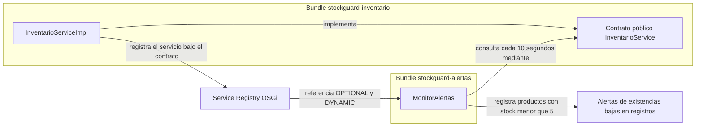

# StockGuard — Sistema Modular de Inventario

StockGuard es una aplicación de servidor de demostración para controlar el inventario de una pequeña tienda de tecnología y accesorios de computación. Mantiene un catálogo de productos en memoria y registra alertas en los registros de ejecución cuando la disponibilidad cae por debajo de cinco unidades.

El proyecto sirve como ejemplo de una aplicación Java modular ejecutada en Apache Karaf. Sus dos bundles OSGi pueden gestionar su ciclo de vida por separado, mientras que el bundle de alertas descubre el servicio de inventario mediante el registro de servicios de OSGi.

## Funcionalidad

- Cargar 15 productos de demostración al activar el componente de inventario.
- Consultar productos ordenados por código y actualizar sus existencias.
- Revisar las existencias cada 10 segundos.
- Registrar una alerta cuando un producto tiene menos de cinco unidades.
- Mantener el monitor activo si Inventario deja de estar disponible y reconectarlo cuando el servicio vuelve.

## Arquitectura

StockGuard está dividido en dos bundles de aplicación: `stockguard-inventario` contiene el contrato y la implementación del inventario; `stockguard-alertas` contiene el monitor que consulta ese contrato. El proyecto Maven de la raíz solo coordina la compilación de ambos módulos (`packaging=pom`), por lo que no genera un tercer bundle de aplicación.

OSGi permite instalar, resolver, iniciar, detener y actualizar módulos dentro de un mismo entorno de ejecución. Para este ejemplo, la separación hace visible el ciclo de vida independiente entre quien ofrece los datos y quien los supervisa. No se trata de una arquitectura de microservicios distribuidos: los bundles se ejecutan en el mismo contenedor Karaf y la comunicación ocurre mediante servicios OSGi.

### Registro de servicios y Declarative Services

El bundle de Inventario implementa `InventarioService` y Declarative Services (DS) publica esa implementación como un servicio en el registro de servicios de OSGi (Service Registry). El registro asocia el servicio con su interfaz pública; otros componentes pueden solicitar una referencia a esa interfaz sin depender de la clase concreta.

`MonitorAlertas` declara con anotaciones DS una referencia de cardinalidad `OPTIONAL` y política `DYNAMIC`. `OPTIONAL` permite que Alertas se active aunque Inventario no esté disponible. `DYNAMIC` permite que DS notifique la llegada o retirada del servicio durante la vida del componente, sin exigir que Alertas se detenga y vuelva a iniciar. El monitor consulta el servicio cuando tiene una referencia y espera la reconexión cuando no la tiene.

DS procesa las anotaciones de componentes y referencias durante la construcción del bundle y genera los descriptores de componentes OSGi. El registro de servicios administra el ciclo de vida de las referencias; no se incorpora un localizador de servicios propio a la aplicación.

### Metadatos OSGi generados

El manifiesto de Inventario identifica el bundle como `com.stockguard.inventario`, exporta `com.stockguard.inventario.api` con versión `1.0.0` y declara la capacidad del servicio `InventarioService`. El manifiesto de Alertas identifica `com.stockguard.alertas` e importa la API de Inventario dentro del rango `[1.0,2)`. Sus descriptores DS se empaquetan bajo `OSGI-INF/`: el descriptor de Alertas declara la referencia con cardinalidad `0..1` y política `dynamic`. La API se empaqueta en el JAR de Inventario y no se duplica en el JAR de Alertas.

### Diagrama de componentes



Inventario expone el contrato y registra su implementación en OSGi. Alertas obtiene una referencia dinámica al contrato, consulta el catálogo y escribe en los registros una alerta por cada producto que cumple el umbral.

### Bundle de Inventario

| Elemento | Responsabilidad |
|---|---|
| `Producto` | Registro de Java (`record`) con código, nombre y cantidad disponible. |
| `InventarioService` | API pública para listar productos y actualizar existencias. |
| `InventarioServiceImpl` | Inicializa el catálogo, consulta y actualiza productos; publica el servicio mediante DS. |

La implementación mantiene los productos en memoria con un `ConcurrentHashMap`. Al activarse el componente, carga el catálogo de demostración. `listarProductos()` devuelve una lista ordenada por código. `actualizarExistencias()` actualiza la cantidad de un producto existente y conserva su código y nombre; las cantidades negativas se rechazan con `IllegalArgumentException` y un código desconocido devuelve `false`.

El POM de Inventario exporta `com.stockguard.inventario.api` como paquete público. `com.stockguard.inventario.internal` es implementación privada y no forma parte del contrato que consumen otros bundles.

### Bundle de Alertas

`MonitorAlertas` es un componente inmediato de DS. Al activarse crea un programador de una sola hebra y ejecuta la consulta de inmediato y luego cada 10 segundos. Por cada producto con `cantidadDisponible < 5`, escribe un mensaje de nivel `WARN` mediante SLF4J. La comparación es estricta: cinco unidades no generan alerta.

La referencia opcional y dinámica se asocia y desvincula mediante métodos de DS. Si Inventario desaparece, el monitor permanece activo y las ejecuciones programadas esperan sin consultar. Cuando el servicio vuelve a publicarse, DS vuelve a asociarlo y el monitor reanuda las consultas. Las excepciones de ejecución al consultar el servicio se registran sin cancelar el monitor.

Al desactivarse, el componente borra su referencia, solicita el cierre inmediato del programador y espera su terminación hasta dos segundos. El paquete `com.stockguard.alertas.internal` es privado. Alertas importa el paquete público de Inventario con un rango de versión; el JAR de Alertas no incorpora copias de las clases de esa API.

## Catálogo inicial

El componente de Inventario carga estos 15 productos al activarse:

| Código | Producto | Existencias iniciales |
|---|---|---:|
| P-001 | Teclado mecánico Logitech | 12 |
| P-002 | Mouse inalámbrico Logitech | 3 |
| P-003 | Monitor Samsung 24 pulgadas | 8 |
| P-004 | Cable HDMI 2 metros | 1 |
| P-005 | Memoria RAM Kingston 16 GB | 20 |
| P-006 | SSD Kingston 1 TB | 14 |
| P-007 | Audífonos HyperX Cloud | 4 |
| P-008 | Webcam Logitech C920 | 7 |
| P-009 | Adaptador USB-C | 2 |
| P-010 | Hub USB 3.0 | 18 |
| P-011 | Disco duro externo 2 TB | 6 |
| P-012 | Router TP-Link Wi-Fi 6 | 9 |
| P-013 | Fuente de poder 650 W | 11 |
| P-014 | Pasta térmica Arctic MX-4 | 25 |
| P-015 | Soporte para laptop | 5 |

Del catálogo, once productos comienzan con existencias normales (cinco o más). Los otros cuatro están bajo el umbral inicial:

| Código | Producto | Existencias |
|---|---|---:|
| P-002 | Mouse inalámbrico Logitech | 3 |
| P-004 | Cable HDMI 2 metros | 1 |
| P-007 | Audífonos HyperX Cloud | 4 |
| P-009 | Adaptador USB-C | 2 |

P-015 tiene exactamente cinco unidades y no genera una alerta. El umbral se aplica con la condición estricta `cantidadDisponible < 5`.

## Estructura del proyecto

```text
StockGuard/
├── README.md
├── pom.xml                              # Agregador Maven; packaging=pom
├── .gitignore
├── stockguard-inventario/
│   ├── pom.xml
│   └── src/
│       ├── main/java/com/stockguard/inventario/
│       │   ├── api/
│       │   │   ├── InventarioService.java
│       │   │   └── Producto.java
│       │   └── internal/
│       │       └── InventarioServiceImpl.java
│       └── test/java/com/stockguard/inventario/internal/
│           └── InventarioServiceImplTest.java
└── stockguard-alertas/
    ├── pom.xml
    └── src/
        ├── main/java/com/stockguard/alertas/internal/
        │   └── MonitorAlertas.java
        └── test/java/com/stockguard/alertas/internal/
            └── MonitorAlertasTest.java
```

Los paquetes `api` de Inventario forman la API pública. Los paquetes `internal` contienen implementaciones y son privados para cada bundle. Los directorios `target/` se generan durante la compilación y no son parte del código fuente.

## Requisitos previos

- JDK 17.
- Maven 3.10.0 o una versión compatible con el POM.
- Apache Karaf 4.4.x para ejecutar los bundles.
- Git.
- Como herramientas de desarrollo, un IDE Java como IntelliJ IDEA, Eclipse o VS Code con soporte Java.

Versiones y alcances declarados en los POM:

| Componente | Versión | Alcance |
|---|---:|---|
| Apache Felix Maven Bundle Plugin | 5.1.9 | Empaquetado OSGi de ambos módulos. |
| Maven Compiler Plugin | 3.13.0 | Compilación con `--release 17`. |
| Anotaciones OSGi Declarative Services | 1.5.1 | `provided`. |
| JUnit Jupiter | 5.14.4 | `test`. |
| Mockito Core | 5.24.0 | `test`, en Alertas. |
| SLF4J API | 1.7.36 | `provided`, en Alertas. |
| Logback Classic | 1.2.13 | `test`, en Alertas. |
| Maven Surefire Plugin | 3.6.1 | Ejecución de pruebas. |

Comprueba las herramientas desde PowerShell:

```powershell
java --version
mvn --version
git --version
```

En la consola de Karaf, `version` muestra la versión del contenedor:

```text
karaf@root()> version
```

## Compilación y pruebas

Desde el directorio raíz del repositorio, ejecuta:

```powershell
mvn clean verify
```

Maven ejecuta el reactor en el orden definido por las dependencias: primero procesa el agregador, construye Inventario y después Alertas. `clean` elimina resultados anteriores; `verify` ejecuta las fases previas, las pruebas configuradas por Surefire y las verificaciones del ciclo Maven. El resultado `BUILD SUCCESS` indica que el reactor terminó sin errores.

JUnit Jupiter 5 ejecuta las pruebas unitarias de ambos módulos. Mockito se usa en las pruebas de Alertas para simular el contrato de Inventario cuando se necesita controlar su comportamiento. Las dependencias de pruebas tienen alcance `test` y no se empaquetan como clases de producción en los bundles.

En la fase de pruebas ya completada se informó que pasaron 18 pruebas: 9 de Inventario y 9 de Alertas. Este dato corresponde a esa validación anterior; no es una ejecución nueva de Karaf. `mvn clean verify` vuelve a ejecutar las pruebas automáticamente.

Los bundles generados están en:

```text
stockguard-inventario/target/stockguard-inventario-1.0.0-SNAPSHOT.jar
stockguard-alertas/target/stockguard-alertas-1.0.0-SNAPSHOT.jar
```

Los informes XML y de texto de Surefire quedan bajo `target/surefire-reports/` en cada módulo.

## Ejecución en Apache Karaf

Las instrucciones separan los comandos de PowerShell de los comandos que se escriben en la consola interactiva de Karaf. Si Karaf ya está ejecutándose, usa su consola existente.

### 1. Iniciar Karaf

En PowerShell, cambia al directorio donde descomprimiste Karaf y ejecuta:

```powershell
Set-Location $env:KARAF_HOME
.\bin\karaf.bat
```

Si no definiste `KARAF_HOME`, sustituye esa línea por la ruta de tu propia instalación. Verifica que el contenedor sea Karaf 4.4.x con `version`.

### 2. Habilitar Declarative Services

En la consola de Karaf, instala SCR si aún no está disponible:

```text
karaf@root()> feature:install scr
```

### 3. Compilar y preparar las ubicaciones locales

En otra ventana de PowerShell, desde la raíz del repositorio:

```powershell
mvn clean verify

$inventarioJar = (Resolve-Path ".\stockguard-inventario\target\stockguard-inventario-1.0.0-SNAPSHOT.jar").Path
$alertasJar = (Resolve-Path ".\stockguard-alertas\target\stockguard-alertas-1.0.0-SNAPSHOT.jar").Path
$inventarioUrl = ([System.Uri]::new($inventarioJar)).AbsoluteUri
$alertasUrl = ([System.Uri]::new($alertasJar)).AbsoluteUri

$inventarioUrl
$alertasUrl
```

Copia las URL `file:///...` impresas para usarlas en la consola de Karaf. Esto evita fijar la ubicación local del repositorio en las instrucciones.

### 4. Instalar los bundles sin duplicarlos

Primero, en Karaf, ejecuta `bundle:list` y busca los nombres simbólicos `com.stockguard.inventario` y `com.stockguard.alertas`. Los ID numéricos asignados por Karaf dependen de cada contenedor.

Si un bundle todavía no aparece, instala su JAR local una sola vez. Sustituye cada URL por la que preparaste en PowerShell:

```text
karaf@root()> bundle:install -s 'file:///ruta/local/stockguard-inventario/target/stockguard-inventario-1.0.0-SNAPSHOT.jar'
karaf@root()> bundle:install -s 'file:///ruta/local/stockguard-alertas/target/stockguard-alertas-1.0.0-SNAPSHOT.jar'
```

Instala Inventario antes que Alertas. Si los bundles ya están instalados, no ejecutes `bundle:install` de nuevo: localiza sus ID con `bundle:list` y actualiza las instalaciones existentes con las URL locales:

```text
karaf@root()> bundle:update <ID_INVENTARIO> 'file:///ruta/local/stockguard-inventario/target/stockguard-inventario-1.0.0-SNAPSHOT.jar'
karaf@root()> bundle:update <ID_ALERTAS> 'file:///ruta/local/stockguard-alertas/target/stockguard-alertas-1.0.0-SNAPSHOT.jar'
```

Después de actualizar, comprueba sus estados con `bundle:list`; si alguno no está `Active`, inícialo con `bundle:start <ID>`. Vuelve a ejecutar `bundle:list` para descubrir los ID actuales en lugar de asumir que conservan valores de otra ejecución.

### 5. Comprobar servicios y registros

En Karaf:

```text
karaf@root()> bundle:list
karaf@root()> service:list com.stockguard.inventario.api.InventarioService
karaf@root()> log:display
```

Se espera que los dos bundles estén `Active`, que el servicio `com.stockguard.inventario.api.InventarioService` aparezca registrado y que los registros de Alertas incluyan las alertas de los cuatro productos bajo el umbral. El monitor ejecuta una primera revisión al activarse y repite cada 10 segundos.

## Demostración de desconexión y recuperación

Esta demostración cambia el estado de bundles en un contenedor Karaf. Debe realizarse en un entorno de desarrollo; no es una prueba automatizada de unidad.

1. En Karaf, ejecuta `bundle:list` y anota el ID actual de Inventario y de Alertas por sus nombres simbólicos.
2. Detén Inventario:

   ```text
   karaf@root()> bundle:stop <ID_INVENTARIO>
   ```

3. Ejecuta `bundle:list`. Inventario debe aparecer como `Resolved`; Alertas debe seguir `Active`.
4. Revisa la desconexión en los registros:

   ```text
   karaf@root()> log:display
   ```

   Se espera el mensaje `Servicio de Inventario desconectado. El monitor continuará esperando la reconexión.`
5. Inicia Inventario de nuevo:

   ```text
   karaf@root()> bundle:start <ID_INVENTARIO>
   ```

6. Confirma que ambos bundles estén `Active` y que `service:list com.stockguard.inventario.api.InventarioService` muestre el servicio.
7. Revisa los registros para el mensaje de conexión y las alertas de existencias bajas. La siguiente consulta programada debe ocurrir dentro del intervalo de 10 segundos sin reiniciar Alertas.

Estos son los resultados esperados según el diseño del componente. La verificación manual de desconexión y reconexión se reportó en una ejecución anterior de Karaf; no se ha repetido como parte de esta fase documental.

## Pruebas automatizadas

El proyecto incluye dos clases de pruebas unitarias:

| Clase | Cobertura principal |
|---|---|
| `InventarioServiceImplTest` | Catálogo inicial de 15 productos, orden y códigos, umbral, actualizaciones, cantidades inválidas, consistencia y acceso concurrente. |
| `MonitorAlertasTest` | Umbral de alertas, servicio ausente/disponible, desconexión y reconexión, errores de consulta, intervalo programado y cierre/reinicio del componente. |

JUnit 5 proporciona las aserciones y el ciclo de ejecución de las pruebas. Mockito permite controlar el servicio de Inventario en los escenarios de Alertas sin iniciar Karaf. La prueba del monitor usa un programador controlado para verificar las tareas sin esperar diez segundos de reloj por cada ciclo.

Estas pruebas son unitarias: ejercitan componentes Java y sus contratos. La instalación de bundles, la publicación efectiva del servicio en el registro y el comportamiento del contenedor son verificaciones de integración que se realizan en Karaf. Los resultados manuales previos descritos arriba no deben confundirse con la ejecución de Surefire.

## Evidencias de ejecución

En esta sesión no fue posible guardar capturas de escritorio: la herramienta de captura devolvió una ventana distinta a VS Code y, al reintentar, no mostró el editor. No se crearon imágenes simuladas; los diez puntos visuales permanecen pendientes.

### Evidencia textual disponible

Se guardaron extractos de ejecuciones reales en `docs/capturas/`:

- [Pruebas automatizadas de Maven](docs/capturas/01-pruebas-automatizadas.txt): salida con 9 pruebas de Inventario y 9 de Alertas, sin fallos, errores ni omisiones.
- [Resultado del reactor Maven](docs/capturas/02-build-success.txt): módulos construidos y `BUILD SUCCESS`.
- [Registro de alertas de Karaf](docs/capturas/03-registro-karaf.txt): cuatro alertas del ciclo observado mientras el monitor seguía ejecutándose. También conserva eventos anteriores de desconexión y reconexión, marcados como historial y no como una demostración repetida durante esta tarea.

El runtime Karaf ya estaba ejecutándose y su registro mostró consultas del monitor. No se pudo consultar `bundle:list` ni `bundle:services` en esta sesión: el cliente SSH local solicitó un usuario, así que se canceló sin ingresar credenciales. Tampoco se detuvieron ni iniciaron bundles. Por eso, los estados actuales y la secuencia de recuperación no se presentan como verificaciones nuevas.

### Capturas de pantalla pendientes

Las capturas PNG se podrán incorporar cuando sea posible obtener una captura dirigida del terminal de Maven y de la consola Karaf. No hay enlaces de imagen hasta que esos archivos existan y se revisen.

- [ ] Salida de Maven con `BUILD SUCCESS`.
- [ ] Resumen de pruebas automatizadas aprobadas.
- [ ] Ambos bundles en estado `Active` en Karaf.
- [ ] Servicio `InventarioService` registrado.
- [ ] Alertas iniciales de los cuatro productos bajo el umbral.
- [ ] Inventario detenido mientras Alertas permanece `Active`.
- [ ] Mensaje de desconexión del servicio de Inventario.
- [ ] Mensaje de reconexión después de iniciar Inventario.
- [ ] Alertas de stock después de la recuperación.
- [ ] Evidencia de los cuatro productos con bajo stock en el catálogo de 15 productos.

## Limitaciones actuales

- El inventario se almacena en memoria y no usa una base de datos.
- La activación del componente vuelve a registrar los datos iniciales de demostración; los cambios realizados durante la ejecución no son persistentes.
- El proyecto todavía no incluye interfaz gráfica ni API REST.
- El monitor registra nuevamente los productos con bajo stock en cada ciclo; no hay deduplicación ni historial de alertas.
- Las existencias no se gestionan mediante una interfaz de usuario. La API del servicio permite actualizarlas desde otro componente OSGi.

Estas limitaciones delimitan el alcance actual del ejemplo y no implican funciones ya implementadas.

## Posibles mejoras futuras

Como extensiones independientes se podrían explorar una interfaz web, una API REST, almacenamiento persistente, un umbral configurable, deduplicación de alertas y operaciones adicionales de inventario. Ninguna de estas posibilidades forma parte de la implementación actual.
